<p align="center">

</p>

# mpv_audio_kit

#### Audio engine for Flutter and Dart.

[](https://pub.dev/packages/mpv_audio_kit)
[]()
[](LICENSE)
[](https://github.com/ales-drnz/mpv_audio_kit)
[](https://discord.gg/g2Qf4Mq9MP)
[](https://www.patreon.com/cw/ales_drnz)
[](https://www.buymeacoffee.com/ales.drnz)

---

## Made for your media library

mpv_audio_kit is an audio player for Flutter apps that play from your own server. It puts mpv and ffmpeg behind a typed Dart API, on Android, iOS, macOS, Windows, Linux and the web.

**[Try it in your browser](https://ales-drnz.github.io/mpv_studio/)**: [mpv_studio](https://github.com/ales-drnz/mpv_studio), the demo app, running libmpv as WebAssembly. Best in Chrome or Edge.

<table>
<tr>
<td valign="middle" width="48"></td>
<td valign="middle"><b>Jellyfin</b><br>Stream your library direct or transcoded. Transcoded streams arrive as <a href="#21-supported-uri-schemes">HLS</a>, and you can still seek in them.</td>
</tr>
<tr>
<td valign="middle"></td>
<td valign="middle"><b>Plex</b><br>Play tracks and playlists over <a href="#21-supported-uri-schemes">HLS or DASH</a>. With the <a href="#124-the-source-resolver">source resolver</a>, each track asks the server for its stream only when it opens, so a long queue starts at once.</td>
</tr>
<tr>
<td valign="middle"></td>
<td valign="middle"><b>Samba</b><br>Play straight from a NAS or any network share over <a href="#21-supported-uri-schemes">SMB2 and SMB3</a>.</td>
</tr>
<tr>
<td valign="middle"></td>
<td valign="middle"><b>Total control</b><br>Tune <a href="#7-network-and-caching">the cache and the network</a>, shape the sound with <a href="#5-audio-effects">a chain of ffmpeg effects</a>, and watch it with <a href="#13-visualizer-waveform-and-loudness">a live spectrum, waveform and loudness meter</a>.</td>
</tr>
</table>

---

## Installation

Add `mpv_audio_kit` to your `pubspec.yaml`:

```yaml
dependencies:
  mpv_audio_kit: ^0.5.3
```

On Android, iOS, macOS, Windows and Linux the build downloads the libmpv binary for the target from the package's GitHub release and checks its SHA-256 (the first build needs network access). On the web the WebAssembly module ships with the package.

## Platform requirements

| Platform  | Minimum | Architecture | Size | Device | Emulator |
| :--- | :--- | :--- | :---: | :---: | :---:
| Android | 7.0 (SDK 24) | arm64-v8a, armeabi-v7a, x86_64 | 8.3, 8.2, 8.9 MB | Yes | Yes |
| iOS | 15.0 | arm64, x86_64 | 7.5, 8.0 MB | Yes | Yes |
| macOS | 12.0 | arm64, x86_64 | 7.5, 8.0 MB | Yes | - |
| Windows | 10 | arm64, x86_64 | 8.1, 9.2 MB | Yes | - |
| Linux | glibc 2.31 (Ubuntu 20.04, Debian 11) | aarch64, x86_64 | 8.8, 8.6 MB | Yes | - |
| Web | a cross-origin isolated page | wasm32 | 4.6 MB (1.9 MB with brotli) | - | - |

- **Dart and Flutter:** Dart 3.10 and Flutter 3.41 or later.

- **iOS:** building for iOS needs Flutter 3.47.4 or later, which targets iOS 15 like the bundled libmpv.

- **Linux:** ALSA (`libasound.so.2`) is required. PipeWire (0.3.57 or later) or PulseAudio is used when installed.

- **Web:** the page must be cross-origin isolated, in a browser with SharedArrayBuffer and AudioWorklet (Chrome and Edge 92, Firefox 79, Safari 15.2 or later). See [15. Web](#15-web).

---

## Contents

- [Visuals](#visuals)
- [Features](#features)
- [Quick start](#quick-start)
- [1. Initialization and lifecycle](#1-initialization-and-lifecycle)
  - [1.1 Global initialization](#11-global-initialization)
  - [1.2 Creating a player](#12-creating-a-player)
  - [1.3 Disposing a player](#13-disposing-a-player)
- [2. Media sources](#2-media-sources)
  - [2.1 Supported URI schemes](#21-supported-uri-schemes)
  - [2.2 HTTP headers](#22-http-headers)
  - [2.3 Extras](#23-extras)
  - [2.4 Demuxer options](#24-demuxer-options)
  - [2.5 Live PCM input](#25-live-pcm-input)
- [3. Playlist management](#3-playlist-management)
  - [3.1 Opening a single track](#31-opening-a-single-track)
  - [3.2 Opening multiple tracks](#32-opening-multiple-tracks)
  - [3.3 Modifying the queue at runtime](#33-modifying-the-queue-at-runtime)
  - [3.4 Navigation](#34-navigation)
  - [3.5 Repeat and shuffle](#35-repeat-and-shuffle)
  - [3.6 Chapter navigation](#36-chapter-navigation)
- [4. Playback control](#4-playback-control)
  - [4.1 Basic controls](#41-basic-controls)
  - [4.2 Seeking](#42-seeking)
  - [4.3 A-B loop](#43-a-b-loop)
  - [4.4 Speed and pitch](#44-speed-and-pitch)
  - [4.5 Volume and mute](#45-volume-and-mute)
  - [4.6 Audio delay](#46-audio-delay)
  - [4.7 Resume playback (watch later)](#47-resume-playback-watch-later)
- [5. Audio effects](#5-audio-effects)
  - [5.1 The effects chain](#51-the-effects-chain)
  - [5.2 Common effects: quick examples](#52-common-effects-quick-examples)
  - [5.3 Available effects](#53-available-effects)
  - [5.4 ReplayGain](#54-replaygain)
  - [5.5 Gapless playback](#55-gapless-playback)
- [6. Hardware and routing](#6-hardware-and-routing)
  - [6.1 Audio output driver](#61-audio-output-driver)
  - [6.2 Exclusive mode](#62-exclusive-mode)
  - [6.3 Device selection](#63-device-selection)
  - [6.4 Output format](#64-output-format)
  - [6.5 SPDIF passthrough](#65-spdif-passthrough)
  - [6.6 Audio client name](#66-audio-client-name)
  - [6.7 Audio track selection](#67-audio-track-selection)
  - [6.8 Reload audio](#68-reload-audio)
  - [6.9 Media role](#69-media-role)
  - [6.10 Audio buffer](#610-audio-buffer)
  - [6.11 Audio stream silence](#611-audio-stream-silence)
  - [6.12 Untimed null output](#612-untimed-null-output)
- [7. Network and caching](#7-network-and-caching)
  - [7.1 Cache configuration](#71-cache-configuration)
  - [7.2 Demuxer memory pool](#72-demuxer-memory-pool)
  - [7.3 Network timeout](#73-network-timeout)
  - [7.4 TLS and SSL verification](#74-tls-and-ssl-verification)
  - [7.5 Proxy and cookies](#75-proxy-and-cookies)
  - [7.6 Radio and live streams](#76-radio-and-live-streams)
  - [7.7 Throttling CDNs and chunked requests](#77-throttling-cdns-and-chunked-requests)
  - [7.8 Monitoring the cache and the network](#78-monitoring-the-cache-and-the-network)
  - [7.9 Dropped connections](#79-dropped-connections)
- [8. Metadata and cover art](#8-metadata-and-cover-art)
  - [8.1 Metadata tags](#81-metadata-tags)
  - [8.2 Cover art](#82-cover-art)
- [9. State and streams](#9-state-and-streams)
  - [9.1 Playback state](#91-playback-state)
  - [9.2 State snapshot](#92-state-snapshot)
  - [9.3 Core streams](#93-core-streams)
  - [9.4 Playlist and track streams](#94-playlist-and-track-streams)
  - [9.5 Audio hardware streams](#95-audio-hardware-streams)
  - [9.6 Effects streams](#96-effects-streams)
  - [9.7 Network and cache streams](#97-network-and-cache-streams)
  - [9.8 File metadata and path streams](#98-file-metadata-and-path-streams)
  - [9.9 Playback timing streams](#99-playback-timing-streams)
  - [9.10 A-B loop streams](#910-a-b-loop-streams)
  - [9.11 Cover art streams](#911-cover-art-streams)
  - [9.12 Runtime diagnostics](#912-runtime-diagnostics)
  - [9.13 Prefetch lifecycle stream](#913-prefetch-lifecycle-stream)
  - [9.14 Visualizer and analysis streams](#914-visualizer-and-analysis-streams)
  - [9.15 Media session streams](#915-media-session-streams)
  - [9.16 Event streams](#916-event-streams)
- [10. Raw API](#10-raw-api)
  - [10.1 Read a property](#101-read-a-property)
  - [10.2 Write a property](#102-write-a-property)
  - [10.3 Send a command](#103-send-a-command)
- [11. Error handling and logging](#11-error-handling-and-logging)
  - [11.1 Typed error stream](#111-typed-error-stream)
  - [11.2 End file stream](#112-end-file-stream)
  - [11.3 Audio output lifecycle](#113-audio-output-lifecycle)
  - [11.4 Log streams](#114-log-streams)
  - [11.5 Exceptions](#115-exceptions)
- [12. Hooks](#12-hooks)
  - [12.1 Registering a hook](#121-registering-a-hook)
  - [12.2 Listening and continuing](#122-listening-and-continuing)
  - [12.3 HTTP headers via hook](#123-http-headers-via-hook)
  - [12.4 The source resolver](#124-the-source-resolver)
  - [12.5 Lazy URL resolution](#125-lazy-url-resolution)
- [13. Visualizer, waveform and loudness](#13-visualizer-waveform-and-loudness)
  - [13.1 Subscribing to the spectrum stream](#131-subscribing-to-the-spectrum-stream)
  - [13.2 Configuring the pipeline](#132-configuring-the-pipeline)
  - [13.3 Raw PCM stream](#133-raw-pcm-stream)
  - [13.4 Per-filter PCM taps](#134-per-filter-pcm-taps)
  - [13.5 Waveform](#135-waveform)
  - [13.6 Loudness](#136-loudness)
  - [13.7 Live loudness meter](#137-live-loudness-meter)
- [14. OS media session](#14-os-media-session)
  - [14.1 Enabling the session](#141-enabling-the-session)
  - [14.2 Overriding metadata](#142-overriding-metadata)
  - [14.3 Artwork and privacy](#143-artwork-and-privacy)
  - [14.4 Reacting to OS commands](#144-reacting-to-os-commands)
  - [14.5 Capabilities, intervals and speeds](#145-capabilities-intervals-and-speeds)
  - [14.6 Audio interruptions](#146-audio-interruptions)
  - [14.7 App identity (desktop)](#147-app-identity-desktop)
- [15. Web](#15-web)
  - [15.1 Serving the page](#151-serving-the-page)
  - [15.2 Sound and the autoplay policy](#152-sound-and-the-autoplay-policy)
  - [15.3 Files the user picks](#153-files-the-user-picks)
  - [15.4 Network](#154-network)
  - [15.5 What differs on the web](#155-what-differs-on-the-web)
- [Permissions](#permissions)
- [Troubleshooting](#troubleshooting)
- [Project background](#project-background)

---

## Visuals

<table>
<tr>
<td valign="middle" width="90"></td>
<td valign="middle">These screenshots come from <a href="https://github.com/ales-drnz/mpv_studio">MPV Studio</a>, an app built on <code>mpv_audio_kit</code>. For a single-file demo, see the <code>example/</code> folder.</td>
</tr>
</table>

**Playback**

<p align="center">
  
</p>

**Queue**

<p align="center">
  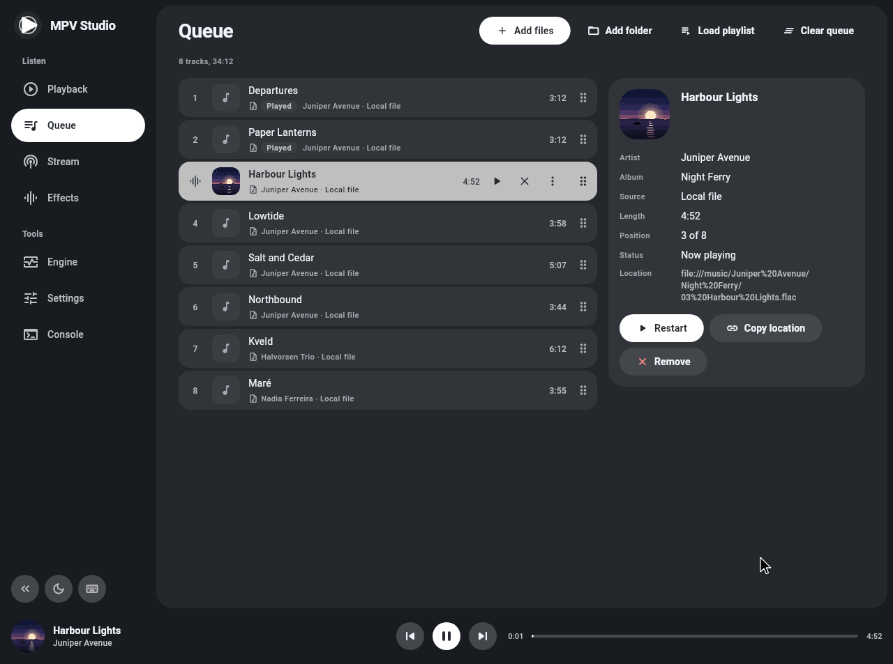
</p>

**Stream**

<p align="center">
  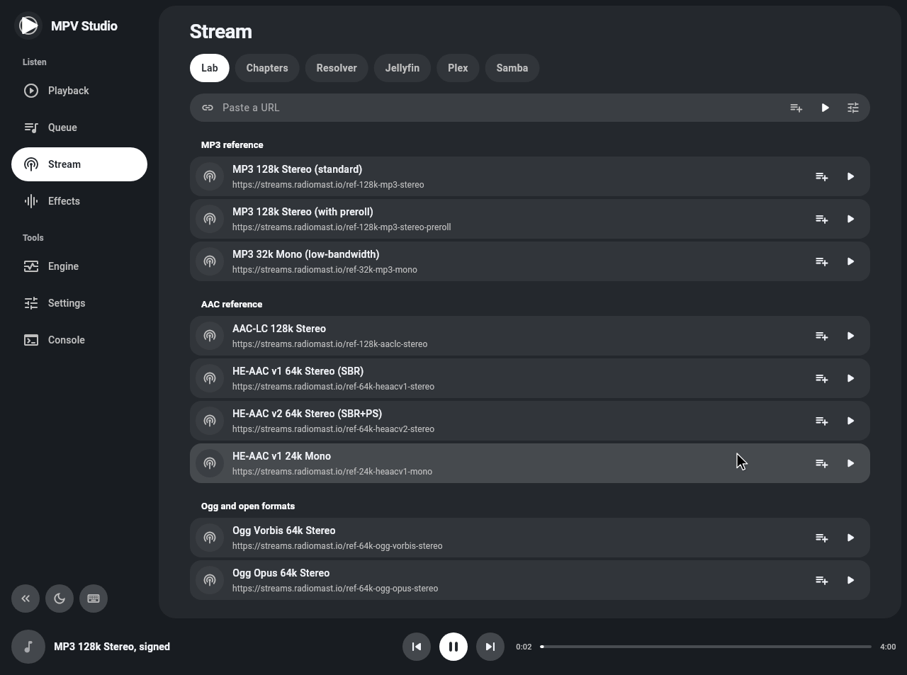
</p>

**Effects**

<p align="center">
  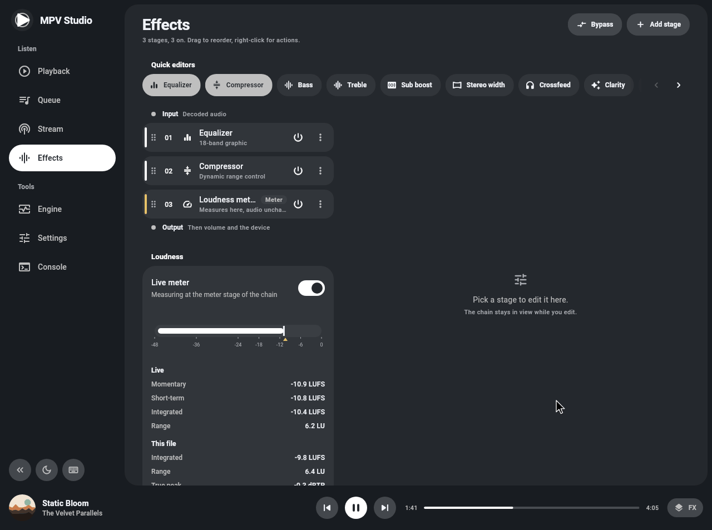
</p>

**Settings**

<p align="center">
  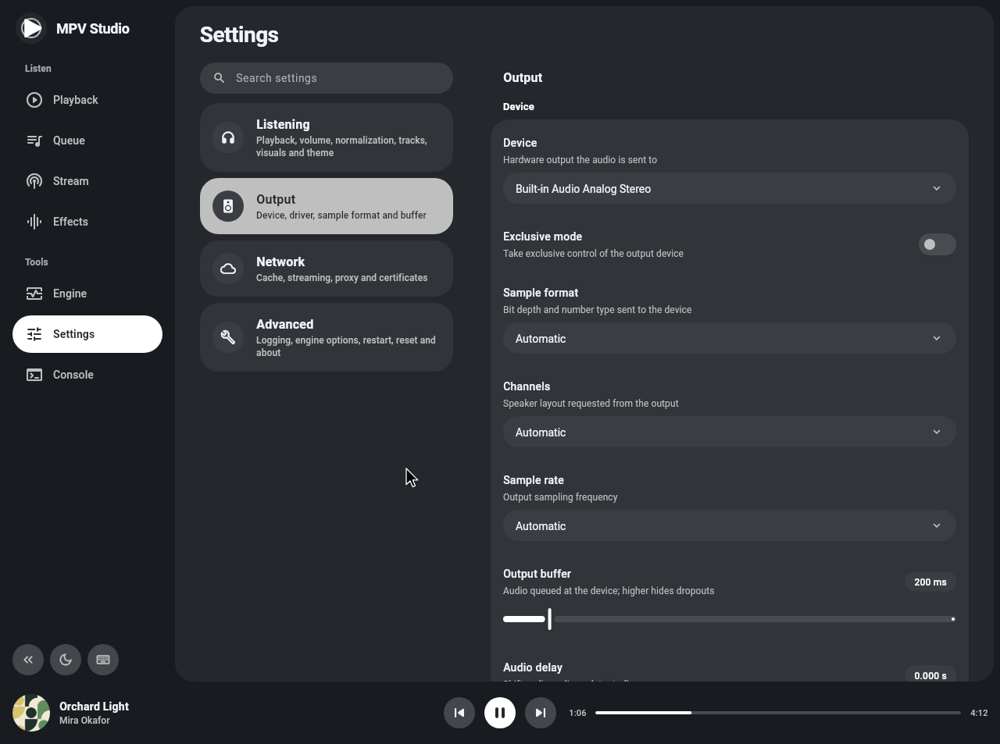
</p>

**Console**

<p align="center">
  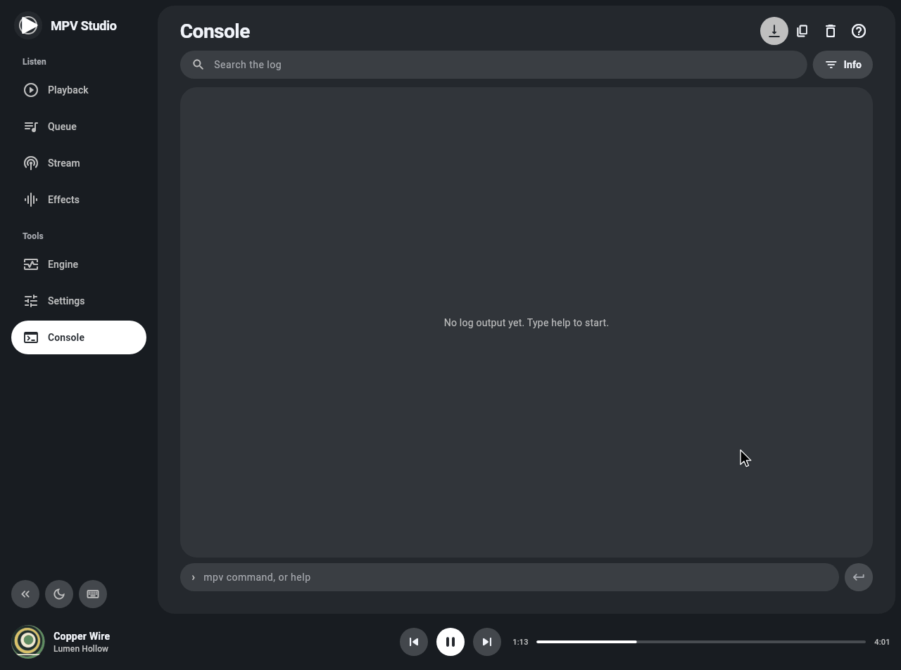
</p>

---

## Features

<table>
<tr>
<td valign="middle" width="48"></td>
<td valign="middle" width="45%"><b>Non-blocking</b><br>player commands are asynchronous and never block the UI thread.</td>
<td valign="middle" width="48"></td>
<td valign="middle" width="45%"><b>Type-safe API</b><br>typed enums, sealed selectors and <code>*Effect</code> classes.</td>
</tr>
<tr>
<td valign="middle"></td>
<td valign="middle"><b>Reactive state</b><br>a synchronous <a href="#92-state-snapshot"><code>state</code></a> snapshot and <a href="#9-state-and-streams">more than 100 streams</a>.</td>
<td valign="middle"></td>
<td valign="middle"><b>Gapless playback</b><br>no gap between tracks, with a <a href="#913-prefetch-lifecycle-stream">prefetch stream</a> to follow the next one.</td>
</tr>
<tr>
<td valign="middle"></td>
<td valign="middle"><b>Effects chain</b><br><a href="#5-audio-effects">typed effects</a> in any order: 18-band EQ, compressor, loudness, pitch and tempo, bass and treble, stereo width, crossfeed, silence trim, and any lavfi filter.</td>
<td valign="middle"></td>
<td valign="middle"><b>Visualizer</b><br>live <a href="#13-visualizer-waveform-and-loudness">FFT spectrum and PCM</a>, a waveform overview and loudness measurement.</td>
</tr>
<tr>
<td valign="middle"></td>
<td valign="middle"><b>ReplayGain</b><br>track or album gain, with preamp and fallback gain.</td>
<td valign="middle"></td>
<td valign="middle"><b>Dynamic playlist</b><br>add, remove, move and replace entries while playing, plus <a href="#36-chapter-navigation">chapters</a> and <a href="#43-a-b-loop">A-B loop</a>.</td>
</tr>
<tr>
<td valign="middle"></td>
<td valign="middle"><b>Multi-track audio</b><br><a href="#67-audio-track-selection">pick the audio track</a> of an MKV or MP4, with codec, language and gain for each.</td>
<td valign="middle"></td>
<td valign="middle"><b>Hardware control</b><br><a href="#62-exclusive-mode">exclusive mode</a>, <a href="#63-device-selection">device selection</a>, <a href="#65-spdif-passthrough">SPDIF passthrough</a>, <a href="#64-output-format">output sample rate and format</a>.</td>
</tr>
<tr>
<td valign="middle"></td>
<td valign="middle"><b>Metadata and cover art</b><br><a href="#81-metadata-tags">tags</a>, and <a href="#82-cover-art">embedded artwork</a> as bytes or a Flutter <code>ImageProvider</code>.</td>
<td valign="middle"></td>
<td valign="middle"><b>Network streams</b><br>HTTP, HTTPS, HLS, DASH and SMB.</td>
</tr>
<tr>
<td valign="middle"></td>
<td valign="middle"><b>Cache control</b><br>one <a href="#71-cache-configuration"><code>CacheSettings</code></a> call sets how far ahead to cache, memory or disk, and the pause when the cache runs empty.</td>
<td valign="middle"></td>
<td valign="middle"><b>Hooks</b><br>run your code while a file loads or <a href="#12-hooks">prefetches</a>, to resolve URLs, redirect or add headers.</td>
</tr>
<tr>
<td valign="middle"></td>
<td valign="middle"><b>Typed errors</b><br>a sealed <a href="#111-typed-error-stream"><code>PlayerError</code></a>, plus streams for end of file, audio output state and logs.</td>
<td valign="middle"></td>
<td valign="middle"><b>Raw access</b><br>read any mpv property, write any except <code>af</code> and <code>pause</code> (the player owns them), and send commands. A command mpv rejects throws <a href="#115-exceptions"><code>MpvCommandException</code></a>.</td>
</tr>
<tr>
<td valign="middle"></td>
<td valign="middle"><b>OS media session</b><br>show the player in the <a href="#14-os-media-session">system media controls</a>: Now Playing and the lock screen on Apple, the Android notification, SMTC on Windows, MPRIS on Linux and the browser's media controls.</td>
<td valign="middle"></td>
<td valign="middle"></td>
</tr>
</table>

---

## Quick start

```dart
import 'package:flutter/material.dart';
import 'package:mpv_audio_kit/mpv_audio_kit.dart';

void main() {
  WidgetsFlutterBinding.ensureInitialized();
  MpvAudioKit.ensureInitialized();
  runApp(const MaterialApp(home: AudioPlayerScreen()));
}

class AudioPlayerScreen extends StatefulWidget {
  const AudioPlayerScreen({super.key});
  @override
  State<AudioPlayerScreen> createState() => _AudioPlayerScreenState();
}

class _AudioPlayerScreenState extends State<AudioPlayerScreen> {
  late final Player player = Player();

  @override
  void initState() {
    super.initState();
    player.open(Media('https://example.com/audio.mp3'));
  }

  @override
  void dispose() {
    player.dispose(); // no need to await it here
    super.dispose();
  }

  @override
  Widget build(BuildContext context) {
    return Scaffold(
      body: Center(
        child: StreamBuilder<Duration>(
          stream: player.stream.position,
          builder: (context, snap) => Text('Position: ${snap.data}'),
        ),
      ),
      floatingActionButton: FloatingActionButton(
        // playWhenReady is what the user asked for; playing also
        // turns off while the player seeks or buffers.
        onPressed: () =>
            player.state.playWhenReady ? player.pause() : player.play(),
        child: const Icon(Icons.play_arrow),
      ),
    );
  }
}
```

---

## 1. Initialization and lifecycle

The player lives on your main isolate and talks to libmpv without blocking it: commands go out asynchronously, and a background isolate brings events and state back.


### 1.1 Global initialization

Call `MpvAudioKit.ensureInitialized()` once at startup, before you create a `Player`.

```dart
void main() {
  WidgetsFlutterBinding.ensureInitialized();
  MpvAudioKit.ensureInitialized();
  runApp(const MyApp());
}
```

To use your own libmpv build instead of the bundled one, either:

- pass its path: `MpvAudioKit.ensureInitialized(libmpv: '/path/to/libmpv')`, or
- bundle it in place of the default with `hooks: user_defines: mpv_audio_kit: libmpv:` in the app's `pubspec.yaml`.

Build it with libmpv-scripts 0.3.0 (libmpv-r20) or later. An older build, or upstream mpv, still plays, and a warning on `stream.internalLog` ([11.4](#114-log-streams)) lists what is missing. On Windows such a build also crashes the process at every `dispose()`, and `previousPlaylist` can crash it.

**Players in another isolate.** Call `ensureInitialized` in that isolate too, with the same `libmpv` if you passed one, and `hotRestartCleanup: false` (in a debug build the cleanup would otherwise destroy the players of the root isolate). There, `asset://` sources do not load (copy the asset to a file first), `content://` needs `BackgroundIsolateBinaryMessenger.ensureInitialized`, and `setMediaSession` throws: the OS media session works only from the root isolate.

### 1.2 Creating a player

```dart
final player = Player(
  configuration: const PlayerConfiguration(
    logLevel: LogLevel.info,
    initialVolume: 100.0,
    autoPlay: true,
  ),
);
```

Every `PlayerConfiguration` field is optional:

<details>
<summary><b>9 configuration fields</b> (click to expand)</summary>

| Field | Default | Description |
| :--- | :--- | :--- |
| `autoPlay` | `false` | `open()` starts playback |
| `initialVolume` | `100.0` | Volume at startup (0 to 100) |
| `logLevel` | `LogLevel.warn` | Lowest level sent to `player.stream.log`: `off`, `fatal`, `error`, `warn`, `info`, `v`, `debug`, `trace` |
| `resumePlayback` | `true` | Restore a saved resume point when a file opens again. Nothing is saved on its own: call `writeResumeConfig()` ([4.7](#47-resume-playback-watch-later)) |
| `watchLaterDir` | `null` | Folder for resume points; set it on mobile, where mpv's default is often not writable |
| `forceSeekable` | `false` | Allow seeking in the cache on streams mpv reports as not seekable (direct HTTP or HLS audio) |
| `hlsBitrate` | `HlsBitrate.max` | Which variant of an adaptive HLS stream to pick: `.no`, `.min` or `.max`. Change it later with `setHlsBitrate` |
| `normalizeDownmix` | `false` | Scale down surround audio mixed to fewer channels so it cannot clip (quieter result) |
| `demuxerCacheDir` | `null` | Folder for the disk cache of `CacheSettings.onDisk`; set it on mobile |

</details>

### 1.3 Disposing a player

Call `dispose()` when you are done. It releases libmpv and the media session, and completes once mpv is gone. The UI keeps running meanwhile.

```dart
await player.dispose();
```

A player lives as long as the isolate that created it. On Android, the Flutter engine can be destroyed while the app's process stays (Back on the root route, a swipe from recent apps): its players then stop and release libmpv on their own. To keep playing after the activity closes, keep the engine alive (cached, or run by a service).

---

## 2. Media sources

A `Media` is a URI plus optional per-track data and options.

```dart
final track   = Media('https://cdn.example.com/audio.flac');
final local   = Media('file:///home/user/music/song.flac');
final asset   = Media('asset:///assets/audio/sample.mp3');
final content = Media('content://com.android.externalstorage.documents/...'); // Android
```

### 2.1 Supported URI schemes

**Local and app-bundled sources**

|  | Scheme | Description |
| :---: | :--- | :--- |
|  | `file://` | Local files, by absolute path |
|  | `asset:///` | Flutter assets bundled in the app |
|  | `content://` | Android content URIs (file picker, media store) |
|  | `blob:` | On the web, files the user picked ([15.3](#153-files-the-user-picks)) |

**Streaming sources**

|  | Scheme | Description |
| :---: | :--- | :--- |
|  | `https://`, `http://` | Files and live streams over HTTP |
|  | `https://…/*.m3u8` | HLS (HTTP Live Streaming), as in Jellyfin transcoding |
|  | `https://…/*.mpd` | DASH (Dynamic Adaptive Streaming over HTTP), as in Plex transcoding |
|  | `smb2://` | SMB2 and SMB3 network shares |

A `file://localhost/...` URL is a local path on every platform.

**Windows notes**

- `file://server/share/...` opens the network share `\\server\share\...`, as `Uri.file` writes it.
- A path of 260 characters or more opens only with long path support. Turn on `LongPathsEnabled` in the registry (needs an administrator) and add this next to `dpiAwareness` in `windows/runner/runner.exe.manifest`. Without both, mpv refuses the file with "Invalid argument".

```xml
<longPathAware xmlns="http://schemas.microsoft.com/SMI/2016/WindowsSettings">true</longPathAware>
```

### 2.2 HTTP headers

`httpHeaders` are sent with every request of that entry, HLS segments included. They never reach other entries.

```dart
await player.open(Media(
  'https://api.example.com/stream/episode-42.mp3',
  httpHeaders: {
    'Authorization': 'Bearer my_token',
    'User-Agent': 'MyApp/1.0',
  },
));
```

For a URL that must be resolved or refreshed when the track opens, use the [source resolver](#124-the-source-resolver).

### 2.3 Extras

`extras` attaches your own data to a track. Playback ignores it, and you read it back from the playlist.

```dart
final media = Media(
  'https://cdn.example.com/track.mp3',
  extras: {
    'title': 'Track Title',
    'artist': 'Artist Name',
    'album': 'Album Name',
    'isPodcast': true,
  },
);

final extras = player.state.playlist.items[index].extras;
```

The OS media session uses `title`, `artist`, `album` and `art` (a cover URL) for files without tags, see [14.2](#142-overriding-metadata).

### 2.4 Demuxer options

`demuxerLavfOptions` passes ffmpeg demuxer options to one entry (mpv's `demuxer-lavf-o`). For example, HLS forwards `seg_format_options` to each segment:

```dart
final media = Media(
  'https://server/Audio/123/main.m3u8?…',
  demuxerLavfOptions: {'seg_format_options': 'advanced_editlist=0'},
);
```

- Keys must not be empty, and values must not contain a comma.
- With `setPrefetchPlaylist(true)`, such an entry and the one after it are not prefetched.
- `streamLavfOptions` does the same for ffmpeg's network protocols (mpv's `stream-lavf-o`), see [7.9](#79-dropped-connections).

### 2.5 Live PCM input

A `PcmSource` plays raw PCM chunks as they arrive, such as generated speech or samples from a socket. No file, no local server, no header.

```dart
final socket = await WebSocket.connect('wss://example.com/speech');
final source = await player.openPcmStream(
  const PcmFormat(sampleRate: 24000, channels: 1), // s16le by default
);
await source.addStream(
  socket.where((m) => m is List<int>).map(
    (m) => m is Uint8List ? m : Uint8List.fromList(m as List<int>),
  ),
);
await source.close();
```

**Feeding a source**

- Encodings (`PcmEncoding`): `u8`, `s16le`, `s24le`, `s32le`, `f32le`, with 1 to 8 channels.
- `add` never blocks. `addStream` pauses its stream while more than `maxBuffered` (30 s by default) is waiting; in a loop of `add` calls, `await source.ready` does the same.
- A chunk may end mid-frame: the rest is joined to the next chunk.
- `close()` plays out what is buffered, then the entry ends normally. `abort()` cuts it at once and moves to the next entry.
- `done` completes when the player has read everything, or when the source is aborted or stopped (`stop`, `next`, another `open`, a removal, a dispose).

**Latency**

Playback starts about 0.2 s after the first chunk, or about 0.1 s with `lowLatency: true`, which sets the output buffer of that entry to 100 ms. Each gap in the input adds up to one buffer of delay.

**Limits**

- A source plays once and cannot seek. `state.duration` follows the audio received so far.
- `Loop.file` and the A-B loop do not repeat it.
- An entry that has played stays in the playlist without its source: going back to it fails its load. Remove it once the playlist has moved past it.
- While it plays, the entry uses `Gapless.no`, no cache pause and, with `lowLatency`, a 100 ms buffer. `setGapless`, `setCache` and `setAudioBuffer` called meanwhile last only until the entry ends.

**Queueing several sources**

Create them with `PcmSource.create` and pass `source.toMedia()` to `openAll` or `add`. Each starts when the previous one ends. The player keeps each queued source alive while its entry is in the playlist.

---

## 3. Playlist management

### 3.1 Opening a single track

```dart
await player.open(media);              // follows PlayerConfiguration.autoPlay
await player.open(media, play: true);  // start now
await player.open(media, play: false); // load, do not start

// Start 12 minutes in
await player.open(Media(path, start: const Duration(minutes: 12)));

// A 30 second preview from 1:00
await player.open(Media(
  url,
  start: const Duration(minutes: 1),
  end: const Duration(minutes: 1, seconds: 30),
));
```

`start` and `end` also work with `openAll`, `add` and `replace`, each time the entry loads. An entry with an `end` finishes there, while `duration` stays the length of the whole file.

### 3.2 Opening multiple tracks

```dart
await player.openAll([track1, track2, track3]);
await player.openAll([track1, track2, track3], index: 1); // start at the second
await player.openAll([track1, track2], play: false);

// A playlist file or URL (.m3u, .m3u8, .pls, .cue): its entries fill the playlist
await player.openPlaylistFile(Media('https://example.com/stations.m3u'));
```

`open()` would keep a playlist file as a single entry. `openPlaylistFile` does not apply the per-`Media` options (headers, `start`, `end` and so on), neither to fetching the list nor to its entries: they use the global network and demuxer settings.

mpv loads an `smb2://` entry of a playlist file only when the list itself is on `smb2://`. To allow it from a local or `https://` list, set `load-unsafe-playlists` to `yes` with `setRawProperty`; this lifts the check for every protocol, so use it only for lists you trust.

### 3.3 Modifying the queue at runtime

```dart
await player.add(newTrack);                                     // append
await player.insert(1, newTrack);                               // before index 1
await player.insert(player.state.playlist.index + 1, newTrack); // play next
await player.remove(0);
await player.move(5, 0);                                        // from 5 to 0
await player.replace(2, newTrack);

await player.clearPlaylist();                  // remove all, stops playback
await player.clearPlaylist(keepCurrent: true); // keep only the current track
```

An index out of range throws `RangeError`.

### 3.4 Navigation

```dart
final moved = await player.next(); // false when there is no next track
await player.previous();
await player.jump(2);              // 0-based, starts playing

await player.next(force: true);    // past the last entry: stop
await player.nextPlaylist();       // next source playlist
await player.previousPlaylist();   // previous source playlist
```

`nextPlaylist` and `previousPlaylist` move between entries that came from different playlist files.

### 3.5 Repeat and shuffle

```dart
await player.setLoop(Loop.off);      // default
await player.setLoop(Loop.file);     // repeat the current track
await player.setLoop(Loop.playlist); // repeat the playlist

await player.setShuffle(true);
await player.setShuffle(false);      // back to the original order
```

`player.stream.loop` follows the mode. Turned on after the queue has ended, a loop rewinds to the start and stays paused: call `play()`.

### 3.6 Chapter navigation

For files with chapter markers, such as audiobooks and podcasts:

```dart
player.stream.chapters.listen((chapters) {
  for (final (i, c) in chapters.indexed) print('$i. ${c.title} @ ${c.time}');
});

player.stream.currentChapter.listen((i) => print('chapter: $i')); // null: none
player.stream.chapterMetadata.listen(print); // tags of the current chapter

await player.setChapter(2); // 0-based; -1 goes to the start of the file
```

A `Chapter` has a `time` and an optional `title`. Chapter times count from the start of playback; add `state.demuxerStartTime` for the source's own timestamps.

For a source without chapters, set your own after the file has loaded. `setChapter` then navigates them, and an empty list clears them:

```dart
await player.setChapters(const [
  Chapter(time: Duration.zero, title: 'Intro'),
  Chapter(time: Duration(minutes: 3), title: 'Part 1'),
]);
```

---

## 4. Playback control

### 4.1 Basic controls

```dart
await player.play();  // start or resume
await player.pause();
await player.stop();  // stop and unload the current file

// For a play/pause button, use playWhenReady
player.state.playWhenReady ? await player.pause() : await player.play();
```

`playing` turns false during seeks and buffering, `playWhenReady` does not. After the queue has ended, `play()` starts the last track again.

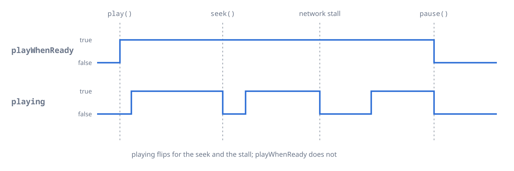

### 4.2 Seeking

```dart
await player.seek(const Duration(seconds: 30));                  // absolute
await player.seek(const Duration(seconds: 10), relative: true);  // forward
await player.seek(const Duration(seconds: -5), relative: true);  // back
await player.seek(const Duration(seconds: 30), exact: true);     // sample-accurate, slower

await player.seekToPercent(50); // 0 to 100, for a progress bar

await player.revertSeek();      // back to where the last jump started
```

`revertSeek` undoes the last seek, chapter change or A-B loop jump. It throws `MpvCommandException` when there is nothing to undo.

### 4.3 A-B loop

Loop a section of the current track, for example to practice a passage.

```dart
await player.setAbLoopA(const Duration(seconds: 30));
await player.setAbLoopB(const Duration(seconds: 45));

await player.setAbLoopCount(3); // jumps back 3 times: the section plays 4 times
                                // null = forever, 0 = off

player.stream.remainingAbLoops.listen((n) => print('left: $n'));

await player.setAbLoopA(null);  // clear
await player.setAbLoopB(null);
```

- The points belong to the current track and reset to `null` when another loads. Points set with no file loaded apply to every file.
- The count stays for the next files.
- Keep both points inside the file.

### 4.4 Speed and pitch

```dart
await player.setRate(1.5);             // 0.01 to 100
await player.setPitch(0.9);            // lower pitch, same speed (0.01 to 100)
await player.setPitchCorrection(true); // default
```

With pitch correction on, a rate other than 1.0 keeps the original pitch. With it off, the pitch follows the speed. For high-quality pitch and tempo changes, use `RubberbandEffect` ([5.2](#52-common-effects-quick-examples)).

### 4.5 Volume and mute

There are two controls: the soft volume (mpv's own gain) and the system volume (the audio driver's).

**Soft volume**, always available:

```dart
await player.setVolume(80.0);    // 100 = unity, above amplifies, max 1000
await player.setMute(true);
await player.setVolumeGain(6.0); // extra gain in dB, -150 to +150
```

The volume scale is cubic: 130 is about +7 dB. `setVolumeMax` (default 130) does not cap `setVolume`; it bounds mpv's relative steps and is a natural top for a slider:

```dart
await player.setVolumeMax(150.0);

Future<void> onVolumeSlider(double value) =>
    player.setVolume(value.clamp(0.0, player.state.volumeMax));
```

`setVolumeGainMin` and `setVolumeGainMax` (defaults -96 and +12 dB) work the same way for the gain.

**System volume**, `setSystemVolume` (0 to 100) and `setSystemMute`. What they move depends on the driver:

| Driver | Effect |
| :--- | :--- |
| PulseAudio, PipeWire, WASAPI shared, CoreAudio on macOS | This app's stream only (CoreAudio has no mute) |
| ALSA, WASAPI exclusive | The whole device, for every app, and it stays after the player is gone |
| iOS, Android, macOS exclusive, null output | Nothing: the calls are ignored and `state.systemVolume` is `null` |

```dart
if (player.state.systemVolume != null) {
  await player.setSystemVolume(70.0);
  await player.setSystemMute(false);
}
```

On Android the app's volume is the system media volume (AudioManager).

### 4.6 Audio delay

```dart
// Positive plays the audio later, negative earlier (e.g. Bluetooth sync)
await player.setAudioDelay(const Duration(milliseconds: 50));
await player.setAudioDelay(const Duration(milliseconds: -200));
```

### 4.7 Resume playback (watch later)

For audiobooks and podcasts, the player can save a resume point for a file and restore it the next time that file opens.

```dart
final player = Player(
  configuration: const PlayerConfiguration(
    resumePlayback: true, // default
    watchLaterDir: '/path/to/app/support/watch_later',
  ),
);

await player.writeResumeConfig();  // save now, e.g. on pause

await player.deleteResumeConfig(); // for the current file
await player.deleteResumeConfig(filename: '/music/audiobook.m4b');
```

- Nothing is saved on its own: call `writeResumeConfig()`, for example when the user pauses or the app goes to the background.
- Saved: position, speed, pitch, volume, mute, audio delay and audio track, but only the values that differ from mpv's startup ones. Not the effects chain. For the volume that base is 100, whatever `initialVolume` says: a volume of 100 is not saved, and reopening the file keeps the current volume.
- On mobile, set `watchLaterDir` to a writable folder.
- A restored value (speed, volume, ...) stays for the following files until you change it.
- mpv deletes a resume point once a load has used it.

If the app keeps the position itself, skip watch later and use `Media.start`. When both apply, `start` wins over the saved position.

```dart
await player.open(Media(path, start: savedPosition));
```

**How a file is identified**

- A resume point is keyed by the file name. Pass `deleteResumeConfig` the same URI you gave `open`.
- A URL with a changing token gets a new key each time. With a [source resolver](#124-the-source-resolver), the key is the URI of the `Media`, which stays the same.
- An Android `content://` source has no resume point: `writeResumeConfig()` writes nothing for it.

---

## 5. Audio effects

Effects are ffmpeg filters, and work the same on every platform.

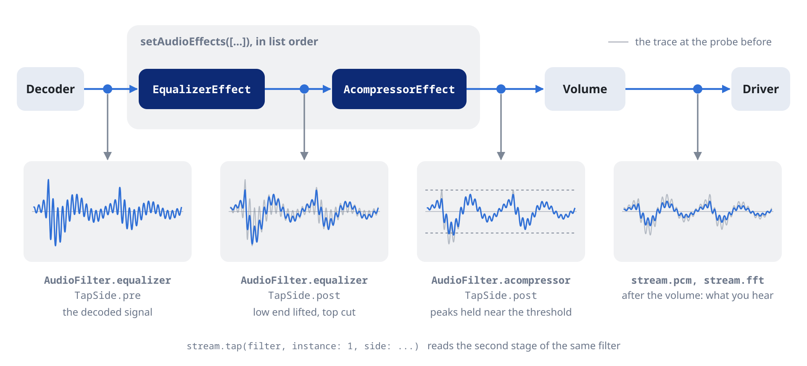

### 5.1 The effects chain

The chain is an ordered list of `AudioEffect` stages, one class per filter (`EqualizerEffect`, `AcompressorEffect` and so on). Stages run in list order, and a filter can appear more than once.

- `setAudioEffects(list)` replaces the whole chain (presets, defaults, restoring saved settings).
- `updateAudioEffects((current) => newList)` changes it from the current list (sliders, toggles).

```dart
await player.setAudioEffects([
  EqualizerEffect(frequency: 100, width: 50, widthType: EqualizerWidthType.h, gain: 3),
  EqualizerEffect(frequency: 8000, width: 1000, widthType: EqualizerWidthType.h, gain: -2),
  AcompressorEffect(threshold: 0.1, ratio: 4),
  AlimiterEffect(limit: 0.9), // limit last
]);
```

Every effect has an `enabled` flag (default `true`). `false` keeps the stage and its settings in the list but bypasses it:

```dart
await player.updateAudioEffects((fx) => [
  for (final e in fx)
    e is AcompressorEffect ? e.copyWith(enabled: false) : e,
]);
```

Read the chain, or follow it as a stream:

```dart
final comp = player.state.audioEffects.whereType<AcompressorEffect>().firstOrNull;

player.stream.audioEffects.listen((fx) => print('${fx.length} stages'));
```

Changing a runtime-tunable parameter (most gains, frequencies and levels; the class docs mark them) updates the running filter without a glitch. Adding, removing, reordering or toggling a stage rebuilds the stages it touches. The chain stays across tracks.

Clear it with:

```dart
await player.setAudioEffects(const []);
```

The chain owns mpv's `af` property, so `setRawProperty('af', ...)` throws. For a filter or option the typed effects do not cover, add a `RawAudioEffect`:

```dart
await player.setAudioEffects(const [
  RawAudioEffect('lavfi-aeval=val(0)*0.5|val(1)*0.5'),
  AcompressorEffect(threshold: 0.1),
]);
```

### 5.2 Common effects: quick examples

Every effect is a class with a const constructor and `copyWith`. Its parameters are ffmpeg's options in camelCase (`level_in` is `levelIn`).

```dart
await player.setAudioEffects(const [
  // Compressor
  AcompressorEffect(threshold: 0.1, ratio: 4.0, attack: 20.0, release: 250.0),

  // EBU R128 loudness normalization
  LoudnormEffect(i: -16, tp: -1.5, lra: 11),

  // Pitch and tempo, independently
  RubberbandEffect(pitch: 1.0594, tempo: 1.0, pitchq: RubberbandPitch.quality),

  // 18-band graphic EQ, bands `1b` to `18b`
  SuperequalizerEffect(params: {'4b': 1.5, '5b': 2.0, '8b': 0.5, '13b': 1.0}),

  // Bass and treble
  BassEffect(gain: 4, frequency: 100),
  TrebleEffect(gain: -2, frequency: 3000),
]);
```

For sliders, every numeric parameter has `static const` bounds and a default (`AcompressorEffect.thresholdMin`, `thresholdMax`, `thresholdDefault`). Parameters with fixed choices are Dart enums (`RubberbandPitch`, `EqualizerWidthType`).

### 5.3 Available effects

There are 87 typed effects, each named after its ffmpeg filter plus `Effect` (`acompressor` is `AcompressorEffect`). For any other `lavfi-*` filter, use `RawAudioEffect`.

<details>
<summary><b>All effects</b> (click to expand)</summary>

**Dynamics and loudness**

| Effect | Description |
|---|---|
| `acompressor` | Compressor |
| `acontrast` | Simple dynamic-range compression |
| `adrc` | Spectral dynamic-range controller |
| `adynamicequalizer` | Dynamic equalizer |
| `adynamicsmooth` | Dynamic smoothing of levels |
| `agate` | Noise gate |
| `alimiter` | Brick-wall limiter |
| `apsyclip` | Psychoacoustic clipper |
| `asoftclip` | Soft clipper |
| `compand` | Compander |
| `deesser` | De-esser |
| `drmeter` | Dynamic-range meter |
| `dynaudnorm` | Adaptive loudness normalization |
| `ebur128` | EBU R128 loudness meter |
| `loudnorm` | EBU R128 loudness normalization |
| `mcompand` | Multiband compander |
| `speechnorm` | Speech loudness normalizer |

**Equalization and tone**

| Effect | Description |
|---|---|
| `anequalizer` | High-order parametric multiband EQ |
| `asubboost` | Subwoofer boost |
| `atilt` | Spectral tilt |
| `bass` | Bass shelf |
| `biquad` | Generic biquad filter |
| `equalizer` | Peaking EQ band |
| `firequalizer` | FIR equalizer, any response |
| `highshelf` | High shelf |
| `lowshelf` | Low shelf |
| `superequalizer` | 18-band graphic EQ |
| `tiltshelf` | Tilt shelf |
| `treble` | Treble shelf |

**Filters**

| Effect | Description |
|---|---|
| `allpass` | All-pass |
| `asubcut` | Subwoofer cut |
| `asupercut` | High-frequency cut |
| `asuperpass` | High-order band-pass |
| `asuperstop` | High-order band-stop |
| `bandpass` | Band-pass |
| `bandreject` | Band-reject |
| `highpass` | High-pass |
| `lowpass` | Low-pass |

**Pitch, tempo and time**

| Effect | Description |
|---|---|
| `afreqshift` | Frequency shift |
| `aphaseshift` | Phase shift |
| `aresample` | Resample |
| `asetrate` | Varispeed (pitch and speed together) |
| `atempo` | Tempo without pitch change |
| `rubberband` | Independent pitch and tempo |

**Stereo and spatial**

| Effect | Description |
|---|---|
| `crossfeed` | Headphone crossfeed |
| `dialoguenhance` | Dialogue enhancement |
| `earwax` | Headphone enhancement |
| `extrastereo` | Wider stereo difference |
| `haas` | Haas stereo widening |
| `stereotools` | Stereo image tools |
| `stereowiden` | Stereo widening |
| `surround` | Stereo to surround upmix |
| `virtualbass` | Psychoacoustic bass |

**Modulation and creative**

| Effect | Description |
|---|---|
| `acrusher` | Bit-crusher |
| `aecho` | Echo and multi-tap delay |
| `aemphasis` | RIAA, FM and disc emphasis curves |
| `aexciter` | Harmonic exciter |
| `aphaser` | Phaser |
| `apulsator` | Auto-panner |
| `crystalizer` | Sharpening |
| `dcshift` | DC offset |
| `flanger` | Flanger |
| `hdcd` | HDCD decoder |
| `tremolo` | Tremolo |
| `vibrato` | Vibrato |

**Denoise, restoration and utility**

| Effect | Description |
|---|---|
| `adeclick` | Click removal |
| `adeclip` | Clip restoration |
| `adecorrelate` | Channel decorrelation |
| `adelay` | Per-channel delay |
| `adenorm` | Fix denormals |
| `aderivative` | Derivative of the signal |
| `afftdn` | FFT noise reduction |
| `afwtdn` | Wavelet noise reduction |
| `aintegral` | Integral of the signal |
| `anlmdn` | Non-local-means denoiser |
| `compensationdelay` | Speaker and microphone delay compensation |

**Spectral, fade and format**

| Effect | Description |
|---|---|
| `afade` | Fade in and out |
| `afftfilt` | Frequency-domain expressions |
| `aformat` | Constrain the output format |
| `aiir` | Arbitrary IIR filter |
| `apad` | Pad with silence |
| `silenceremove` | Trim silence |

**Required parameter**

These five need a value with no sensible default, so their constructor requires it.

| Effect | Description | Required |
|---|---|---|
| `aeval` | Per-channel expressions | `exprs` |
| `arnndn` | RNN speech denoiser | `model` (a `.rnnn` file) |
| `channelmap` | Remap channels | `map` |
| `chorus` | Chorus | `delays`, `decays`, `speeds`, `depths` |
| `pan` | Mix channels with explicit gains | `args` |

</details>

### 5.4 ReplayGain

```dart
await player.setReplayGain(const ReplayGainSettings(
  mode: ReplayGain.track, // .no (default), .track, .album
  preamp: 2.0,            // dB on top of the ReplayGain value
  fallback: -6.0,         // dB for files without ReplayGain tags
  clip: false,            // false: lower the gain so peaks do not clip
));

// Change one field
await player.setReplayGain(
  player.state.replayGain.copyWith(mode: ReplayGain.album),
);
```

### 5.5 Gapless playback

```dart
await player.setGapless(Gapless.weak); // default: gapless when formats allow
await player.setGapless(Gapless.yes);  // always; later tracks use the first track's format
await player.setGapless(Gapless.no);   // off
```

On network playlists, turn on prefetch so the next track opens before the current one ends. Its progress shows on the [prefetch lifecycle](#913-prefetch-lifecycle-stream) stream.

```dart
await player.setPrefetchPlaylist(true);
```

---

## 6. Hardware and routing

### 6.1 Audio output driver

`setAudioDriver` picks the driver mpv uses for audio output:

```dart
await player.setAudioDriver('wasapi');    // Windows
await player.setAudioDriver('coreaudio'); // macOS
await player.setAudioDriver('audiounit'); // iOS
await player.setAudioDriver('aaudio');    // Android, also 'audiotrack' and 'opensles'
await player.setAudioDriver('pipewire');  // Linux, also 'pulse' and 'alsa'
await player.setAudioDriver('auto');      // mpv picks (default)
```

On Android `auto` picks `audiotrack`, the right choice for most apps. `aaudio` needs Android 8 (API 26), and `opensles` plays stereo only.

When no device can be opened, playback goes on silently on mpv's `null` output: `state.currentAo` reads `'null'` and `stream.error` gets a `LogError` ([11.3](#113-audio-output-lifecycle)).

### 6.2 Exclusive mode

Asks the driver for exclusive use of the device:

```dart
await player.setAudioExclusive(true);
await player.setAudioExclusive(false); // back to shared mode
```

What it does depends on the driver:

| Driver | Effect |
| :--- | :--- |
| WASAPI (Windows), CoreAudio (macOS) | Takes the device and switches it to the track's rate when it can, so the system mixer neither resamples nor sets the volume. Other apps have no sound on that device. |
| PipeWire (Linux) | Keeps other streams off the sink. PipeWire's volume still applies, and it resamples when the rate is not one the server allows. |
| `aaudio` (Android) | Exclusive only with `aaudio-performance-mode` set to `low-latency`, on Android 8.1 (API 27) or later with a device that supports it. The system decides; other apps keep playing. |
| iOS | No effect: the app's audio never mixes with other apps. |
| Others, `audiotrack` included | Ignored. |

With WASAPI and CoreAudio the player keeps the device while paused and at the end of the queue. Call `stop()`, `setAudioExclusive(false)` or `dispose()` to give it back.

In exclusive mode `setSystemVolume` moves the device's own volume on Windows and does nothing on macOS (see [4.5](#45-volume-and-mute)).

```dart
// Android: ask aaudio for an exclusive low-latency stream
await player.setAudioDriver('aaudio');
await player.setRawProperty('aaudio-performance-mode', 'low-latency');
await player.setAudioExclusive(true);
```

### 6.3 Device selection

```dart
// Available devices
player.stream.audioDevices.listen((devices) {
  for (final d in devices) {
    print('${d.name}: ${d.description}');
  }
});

// Switch to a device, or back to the system default
await player.setAudioDevice(player.state.audioDevices.first);
await player.setAudioDevice(Device.auto);
```

`name` is mpv's device id and `description` the label to show.

On Android the list holds one entry per driver (`Default (audiotrack)` and the like), not physical devices. The system routes the audio to the speaker, headphones or Bluetooth itself.

### 6.4 Output format

Force the output sample rate, sample format or channel layout, for example to match what a DAC accepts. A change during playback reopens the output, with a short gap.

```dart
// Sample rate in Hz, 0 for auto
await player.setAudioSampleRate(0);
await player.setAudioSampleRate(44100);
await player.setAudioSampleRate(96000);

// Sample format
await player.setAudioFormat(Format.auto);    // mpv picks (default)
await player.setAudioFormat(Format.s16);
await player.setAudioFormat(Format.float32);

// Channel layout
await player.setAudioChannels(Channels.auto);     // what the device accepts, keeping the source layout when it can
await player.setAudioChannels(Channels.autoSafe); // the system's preferred layout, or stereo
await player.setAudioChannels(Channels.stereo);
await player.setAudioChannels(Channels.fiveOne);
await player.setAudioChannels(const Channels.custom('fl-fr-fc-bl-br-sl-sr-lfe')); // any layout mpv accepts
```

**Formats:** `u8`, `s16`, `s32`, `s64`, `float32`, `float64`, each also planar (`s16Planar`, `float32Planar`, …).

**Layouts:** named constants from `mono` to `surround222` (22.2), for example `stereo`, `downmix`, `twoOne`, `quad`, `fiveOne`, `fiveOneSide`, `sevenOne`, `sevenOneWide`, `octagonal`, `hexadecagonal`. Anything else goes through `Channels.custom`.

When you downmix, for example 5.1 to stereo, create the player with `PlayerConfiguration(normalizeDownmix: true)` so the mix cannot clip.

The driver can still change what you ask for: `state.audioOutParams` shows what the device gets. On Android:

- `audiotrack` (the default) plays only 8-bit, 16-bit and float samples, at most at the device's native rate, usually 48 kHz. Other integer formats become 16-bit, so a 24-bit file loses resolution: use `Format.float32` to keep it.
- `aaudio` takes 32-bit integers from Android 12 (API 31).
- `opensles` plays stereo only.

### 6.5 SPDIF passthrough

`setAudioSpdif` sends compressed audio (AC3, E-AC3, DTS, DTS-HD, TrueHD) untouched to an AV receiver over SPDIF or HDMI:

```dart
// Dolby and DTS-HD
await player.setAudioSpdif({Spdif.ac3, Spdif.eac3, Spdif.trueHd, Spdif.dtsHd});

// Off
await player.setAudioSpdif({});
```

The receiver decodes the stream, so while a track passes through:

- the effects chain, soft volume and mute, ReplayGain, volume gain and pitch do not apply;
- a speed other than 1 drops or repeats parts of the stream instead of stretching it;
- the output format settings of [6.4](#64-output-format) do not apply;
- `fft`, `pcm`, the taps and the loudness meter emit nothing.

When the output refuses the format, mpv decodes the track instead. To check, read `getRawProperty('audio-out-params/format')`: it starts with `spdif-` while a track passes through.

Changing the list during playback reopens the decoder, with a short gap.

### 6.6 Audio client name

`setAudioClientName` sets the name system mixers show for the app (default `mpv_audio_kit`):

```dart
await player.setAudioClientName('MyMusicApp');
```

### 6.7 Audio track selection

For files with several audio tracks, such as an MKV or MP4 with one track per language, `state.tracks` lists them and `stream.currentAudioTrack` follows the selected one:

```dart
// List the audio tracks
for (final t in player.state.tracks.where((t) => t.type == 'audio')) {
  print('${t.id}: ${t.title ?? t.lang ?? "audio"} (${t.codec} ${t.sampleRate} Hz)');
}

// Switch track
await player.setAudioTrack(const Track.id(2));
await player.setAudioTrack(Track.auto); // the file's default or the first audio track
await player.setAudioTrack(Track.off);  // no audio

// Add an external audio file as a track of the current file, then remove it
await player.addAudioTrack(Media('commentary.mka'), title: 'Commentary');
await player.removeAudioTrack(const Track.id(3));
```

`MpvTrack` carries the codec, decoder, sample rate, channels, language, ReplayGain tags and the default and forced flags. `external` and `externalFilename` mark a track from a separate file, and `image` and `albumArt` let a track picker skip pictures.

`rescanExternalFiles()` looks again for files next to the current one. It finds only what mpv's auto-load options allow: cover images need `setCoverArtAuto` ([8.2](#82-cover-art)), audio files need mpv's `audio-file-auto` set with `setRawProperty`.

### 6.8 Reload audio

`reloadAudio` closes and reopens the audio output:

```dart
await player.reloadAudio();
```

### 6.9 Media role

`setAudioMediaRole(true)` reports the stream as music:

```dart
await player.setAudioMediaRole(true);
```

- PulseAudio and PipeWire use the role for routing and per-role volume.
- On Android, `audiotrack` and `aaudio` (from Android 9, API 28) only tag the content type as music: routing and volume do not change.
- Other drivers ignore it.

### 6.10 Audio buffer

`setAudioBuffer` sets the size of the audio output buffer, from 0 to 10 s (default 200 ms). A smaller buffer lowers latency; a larger one copes better with load and wireless outputs:

```dart
await player.setAudioBuffer(const Duration(milliseconds: 100)); // low latency
await player.setAudioBuffer(const Duration(milliseconds: 500)); // Bluetooth, slow hardware
```

### 6.11 Audio stream silence

`setAudioStreamSilence(true)` keeps the device open while paused, sending silence, so resuming does not click or pop:

```dart
await player.setAudioStreamSilence(true);
```

- On iOS the driver then never lets go of the device: after an interruption, such as a phone call or another app's audio, it stays suspended and playback cannot continue.
- On Android the default `audiotrack` driver streams the silence.

### 6.12 Untimed null output

`setAudioNullUntimed(true)` makes the `null` driver run as fast as possible instead of in real time, for example to process audio on a machine with no sound device. It also applies when mpv falls back to `null` because the device failed to open:

```dart
await player.setAudioNullUntimed(true);
```

On the web there is one output, the page's: see [15.5](#155-what-differs-on-the-web) for what the settings of this chapter do there.

---

## 7. Network and caching

### 7.1 Cache configuration

`setCache` sets mpv's cache options in one call:

```dart
await player.setCache(const CacheSettings(
  mode: Cache.yes,                 // .auto (default), .yes, .no
  secs: Duration(seconds: 30),     // how much to cache ahead of the playhead
  onDisk: true,                    // keep the cache in a file instead of memory
  pause: true,                     // pause when the cache runs dry (default)
  pauseWait: Duration(seconds: 3), // cached time needed to resume (default 1 s)
  pauseInitial: true,              // also wait before starting and after a seek
));

// Change one field
await player.setCache(
  player.state.cache.copyWith(secs: const Duration(seconds: 60)),
);
```

`pauseInitial` gives network sources a smoother start, and works only with `pause` on.

With `onDisk`, create the player with `PlayerConfiguration(demuxerCacheDir: ...)` pointing at a writable folder: mpv's default location is often not writable on mobile.

### 7.2 Demuxer memory pool

The demuxer reads the container (MP4, MKV, Ogg) and buffers its packets. `setDemuxer` sets how much it keeps:

```dart
await player.setDemuxer(const DemuxerSettings(
  maxBytes: 50 * 1024 * 1024,      // ahead of the playhead, default 150 MiB
  maxBackBytes: 20 * 1024 * 1024,  // behind the playhead, default 50 MiB
  readahead: Duration(seconds: 5), // default 1 s
));
```

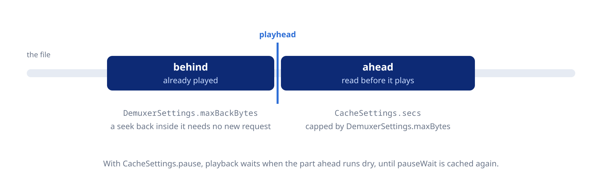

`maxBytes` is what bounds the cache in practice: the default `CacheSettings.secs` is 1000 hours.

For live radio, where you do not seek back, set the back buffer to zero to save memory:

```dart
await player.setDemuxer(player.state.demuxer.copyWith(maxBackBytes: 0));
```

### 7.3 Network timeout

```dart
await player.setNetworkTimeout(const Duration(seconds: 10)); // give up after 10 s without data
```

- Default 60 s. `Duration.zero` uses ffmpeg's default for each protocol.
- The longest timeout is about 36 minutes (2147.483647 s): a longer one is capped there.
- For `smb2://`, zero gives the connection 30 s, with no limit on the reads after it.

### 7.4 TLS and SSL verification

Certificate verification is off by default, as in mpv. Turn it on with `setTlsVerify`:

```dart
await player.setTlsVerify(true); // uses the Mozilla CA roots built into libmpv

// Replace the built-in roots with your own bundle, e.g. a company CA
await player.setTlsCaFile('/path/to/corporate-ca.pem'); // empty string goes back to the built-in roots
```

### 7.5 Proxy and cookies

Both take effect from the next load:

```dart
await player.setHttpProxy('http://proxy.example:8080'); // empty string clears it
await player.setCookies(true);                          // mpv's cookie jar, off by default
```

`http://` and `https://` sources go through the proxy, `https://` ones tunnelled with `CONNECT`.

### 7.6 Radio and live streams

For live radio, turn off the cache and the cache pause to keep latency low:

```dart
await player.open(Media('https://stream.radio.example.com/live.mp3'));
await player.setCache(const CacheSettings(mode: Cache.no, pause: false));
```

To reopen a radio when the connection drops, see [7.9](#79-dropped-connections).

HLS streams, such as Jellyfin's transcoded ones, work with the default cache settings:

```dart
await player.open(Media(
  'https://jellyfin.example.com/audio/stream.m3u8',
  httpHeaders: {'Authorization': 'MediaBrowser Token="..."'},
));
```

Two `PlayerConfiguration` fields help with streams:

```dart
final player = Player(
  configuration: const PlayerConfiguration(
    forceSeekable: true,         // seek within the cache on streams mpv reports as not seekable
    hlsBitrate: HlsBitrate.min,  // lowest-bitrate HLS variant, to save data (default .max)
  ),
);

// The HLS choice can change later, from the next load
await player.setHlsBitrate(HlsBitrate.max);
```

### 7.7 Throttling CDNs and chunked requests

Some CDNs, YouTube's `googlevideo` among them, slow a single open-ended HTTP request to a crawl. Playback starts fine, then stalls after a seek once the buffer runs out.

`Media.httpChunkSize` splits the download into bounded range requests, each served at full speed:

```dart
await player.open(Media(
  googlevideoUrl,
  httpChunkSize: 8 * 1024 * 1024, // 8 MiB, must be positive
));
```

It applies to that track only. Leave it `null` (the default) for servers that do not throttle, such as Plex, Jellyfin or your own: one request buffers fastest there.

### 7.8 Monitoring the cache and the network

`stream.demuxerCacheState` gives the buffered time ranges, the download rate and the `eofCached`, `bofCached` and `underrun` flags of a streaming source. It is empty for local files.

Draw `seekableRanges` as the buffered parts of a seek bar:

```dart
player.stream.demuxerCacheState.listen((cache) {
  for (final r in cache.seekableRanges) {
    print('buffered ${r.start} to ${r.end}');
  }
});
```

`stream.pausedForCache` is `true` while playback waits for an empty cache to refill, the clearest sign of a network stall. `stream.demuxerViaNetwork` tells whether the current file comes over the network.

```dart
player.stream.pausedForCache.listen((waiting) {
  if (waiting) showBufferingIndicator();
});
```

### 7.9 Dropped connections

The player sets mpv's global `stream-lavf-o` to `reconnect=1,reconnect_delay_max=7,reconnect_on_network_error=1,seg_max_retry=4`, so a dropped connection is retried instead of ending the track early:

- A download cut short resumes where it stopped, after 0, 1, 3 and 7 s, on a server that accepts range requests. This covers files and HLS segments.
- A connection that fails to open (refused, reset, unknown host, TLS error) is retried on the same schedule. A server that stays unreachable fails the entry after about 11 s.
- An HLS segment that fails to open is requested four more times before it is skipped.

Protocols other than HTTP, such as `smb2://`, ignore these options.

Setting `stream-lavf-o` with `setRawProperty` replaces the defaults. To add a key and keep them, use `change-list`:

```dart
await player.sendRawCommand(['change-list', 'stream-lavf-o', 'add', 'timeout=5000000']);
```

`Media.streamLavfOptions` adds options for one entry, and wins over the global value:

```dart
// Fail at once on an unreachable server
Media(url, streamLavfOptions: {'reconnect_on_network_error': '0'});
```

A live stream that drops is not reopened by default. Turn it on for a radio with `reconnect_streamed`:

```dart
await player.open(Media(
  'https://stream.radio.example.com/live.mp3',
  streamLavfOptions: {'reconnect_streamed': '1'},
));
```

Use it for live streams only: a file from a server without range support would start over from the beginning after a cut.

With `setPrefetchPlaylist(true)`, an entry with stream options is opened ahead only when the playing entry has the same ones.

---

## 8. Metadata and cover art

### 8.1 Metadata tags

```dart
player.stream.metadata.listen((tags) {
  print('Now playing: ${tags['title']}, ${tags['artist']}');
});

// Synchronous access
final album = player.state.metadata['album'];
```

Keys keep the case the file's tag format uses: ID3 and MP4 tags come in lowercase (`title`), Vorbis comments in FLAC, Ogg and Opus in uppercase (`TITLE`). Look them up case-insensitively:

```dart
String? tag(Map<String, String> tags, String key) => tags.entries
    .where((e) => e.key.toLowerCase() == key)
    .map((e) => e.value)
    .firstOrNull;
```

Common keys: `title`, `artist`, `album`, `album_artist`, `date`, `track`, `disc`, `genre`, `comment`, `composer`.

### 8.2 Cover art

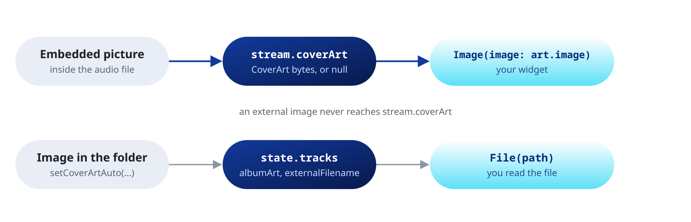

`state.coverArt` and `stream.coverArt` carry the cover embedded in the file, as the original image bytes:

```dart
StreamBuilder<CoverArt?>(
  stream: player.stream.coverArt,
  builder: (context, snap) {
    final art = snap.data;
    if (art == null) return const Icon(Icons.music_note, size: 96);
    return Image(image: art.image, fit: BoxFit.cover);
  },
)
```

| Member | Type | Description |
| :--- | :--- | :--- |
| `bytes` | `Uint8List` | The image as stored in the file, not re-encoded |
| `mimeType` | `String` | `image/png`, `image/jpeg`, `image/webp`, `image/bmp`, `image/gif`, or `application/octet-stream` when mpv does not report it |
| `image` | `ImageProvider` | A `MemoryImage` of the bytes, for `Image(image: …)` |
| `extension` | `String` | `png`, `jpg`, `webp`, `bmp`, `gif`, or empty for an unknown type |
| `isPng`, `isJpeg`, `isWebp`, `isBmp`, `isGif` | `bool` | Type checks |

Saving it to disk:

```dart
final art = player.state.coverArt;
if (art != null) {
  await File('${dir.path}/cover.${art.extension}').writeAsBytes(art.bytes);
}
```

**When it emits**

- On every file load, before playback starts, including mpv's reloads of the same file.
- `null` for a file with no embedded picture, so the UI clears the previous cover.
- `null` also when `open`, `openAll` or `openPlaylistFile` return, so the new cover always follows a `null`.

**External cover files**

`setCoverArtAuto` makes mpv load an image next to the audio file as an extra track. It is off by default (mpv's own default is `exact`), so unrelated images do not get in:

```dart
await player.setCoverArtAuto(Cover.no);    // off (default)
await player.setCoverArtAuto(Cover.exact); // same base name as the audio file, or cover.jpg, folder.jpg and the like
await player.setCoverArtAuto(Cover.fuzzy); // also any image whose name contains the audio file's base name
await player.setCoverArtAuto(Cover.all);   // every image in the folder
```

That image does not reach `stream.coverArt`. Find it among the tracks and read the file yourself:

```dart
final path = player.state.tracks
    .where((t) => t.external && t.albumArt)
    .firstOrNull
    ?.externalFilename;
```

---

## 9. State and streams

The player exposes its state in two ways:

- `player.state`: an immutable snapshot, read synchronously.
- `player.stream`: streams for `StreamBuilder` or `listen()`.

A state stream (`volume`, `position`, `playlist`, `playbackState`, `coverArt`, …) gives each new subscriber the current value first, then every change, so a `StreamBuilder` needs no `initialData`. To wait for the next change, skip it: `player.stream.volume.skip(1).first`.

Event streams (`seekCompleted`, `endFile`, `error`, `log`, `internalLog`, `hook`, `mediaSessionCommands`, `fft`, `pcm`, `loudnessMeter`, taps) deliver only what happens after `listen()`.

In the tables below, a dash under "Set with" marks a read-only stream.

### 9.1 Playback state

`stream.playbackState` folds `playing`, `buffering`, `completed`, `pausedForCache` and whether a file is loaded into one value, for a UI that shows a single indicator:

```dart
player.stream.playbackState.listen((phase) {
  switch (phase) {
    case MpvPlaybackState.idle:      // no file loaded
    case MpvPlaybackState.loading:   // file opening
    case MpvPlaybackState.buffering: // waiting for the network during playback
    case MpvPlaybackState.playing:   // producing audio
    case MpvPlaybackState.paused:    // file loaded, not producing audio
    case MpvPlaybackState.completed: // end of the last track, no loop on
  }
});
```

A paused live stream is `paused`, not `idle`.

### 9.2 State snapshot

`player.state` holds the current value of the state streams, for one-shot reads in event handlers and `build()`:

```dart
final s = player.state;
print(s.playing);                 // bool
print(s.position);                // Duration
print(s.volume);                  // double
print(s.metadata['title']);       // String?
print(s.audioParams.codec);       // String?
print(s.cache.secs);              // Duration
print(s.audioOutputState);        // AudioOutputState

// index is -1 while openAll is still building the queue
final i = s.playlist.index;
if (i >= 0 && i < s.playlist.items.length) {
  print(s.playlist.items[i].uri);
}
```

Some values live on one side only:

- Stream only: `playbackState`, `prefetchState`, `prefetchCacheDuration`, `waveform`, `loudnessScan`, and the event streams.
- State only: `tlsCaFile`, and `readError` and `skippedSegments` (see [11.2](#112-end-file-stream)).

### 9.3 Core streams

| Stream | Type | Set with | Notes |
| :--- | :--- | :--- | :--- |
| `playWhenReady` | `bool` | `play`, `pause`, `open`, `stop` | Whether the user wants playback. Unchanged by seeks and buffering: bind the play-pause button to it. |
| `playing` | `bool` | - | `true` only while audio is produced. Flips during seeks and buffering: use it for a spinner. |
| `completed` | `bool` | - | `true` at the end of the last track, or of the only one. Stays `false` between tracks and while a loop is on. |
| `eofReached` | `bool` | - | mpv's `eof-reached`: the decoder reached the end of the file. |
| `position` | `Duration` | `seek` | Current position, updated at most about 30 times a second. |
| `duration` | `Duration` | - | `Duration.zero` for live streams and while unknown. |
| `buffering` | `bool` | - | `true` while a file opens. A stall during playback shows on `pausedForCache`. |
| `buffer` | `Duration` | - | Timestamp the demuxer has buffered up to. |
| `bufferDuration` | `Duration` | - | Buffered time ahead of the playhead. |
| `bufferingPercentage` | `double` (0-100) | - | Cache fill against `state.cache.secs`, so near 0 with the default 1000 hours. For an indicator use `cacheBufferingState`, or `bufferDuration` against your own target. |
| `volume` | `double` | `setVolume` | 0 to 1000; 100 is unity. |
| `mute` | `bool` | `setMute` |  |
| `rate` | `double` | `setRate` | Speed multiplier. |
| `pitch` | `double` | `setPitch` | Pitch multiplier. |
| `pitchCorrection` | `bool` | `setPitchCorrection` | Keeps the pitch when the rate changes. Default `true`. |
| `audioDelay` | `Duration` | `setAudioDelay` |  |

Audio is playing when `playWhenReady && playing`.

### 9.4 Playlist and track streams

| Stream | Type | Set with | Notes |
| :--- | :--- | :--- | :--- |
| `playlist` | `Playlist` | `open`, `openAll`, `add`, `insert`, `remove`, `move`, `replace`, `clearPlaylist` |  |
| `loop` | `Loop` | `setLoop` |  |
| `shuffle` | `bool` | `setShuffle` |  |
| `prefetchPlaylist` | `bool` | `setPrefetchPlaylist` |  |
| `tracks` | `List<MpvTrack>` | - | From the file |
| `currentAudioTrack` | `MpvTrack?` | `setAudioTrack` |  |
| `chapters` | `List<Chapter>` | - | From the file |
| `currentChapter` | `int?` | `setChapter` |  |

### 9.5 Audio hardware streams

| Stream | Type | Set with | Notes |
| :--- | :--- | :--- | :--- |
| `audioDevice` | `Device` | `setAudioDevice` |  |
| `audioDevices` | `List<Device>` | - |  |
| `audioParams` | `AudioParams` | - | From the decoder |
| `audioOutParams` | `AudioParams` | - | Sent to the output |
| `audioBitrate` | `double?` | - |  |
| `audioOutputState` | `AudioOutputState` | - | See [11.3](#113-audio-output-lifecycle) |
| `audioDriver` | `String` | `setAudioDriver` | Empty for the automatic choice |
| `audioExclusive` | `bool` | `setAudioExclusive` |  |
| `audioBuffer` | `Duration` | `setAudioBuffer` |  |
| `audioStreamSilence` | `bool` | `setAudioStreamSilence` |  |
| `audioNullUntimed` | `bool` | `setAudioNullUntimed` |  |
| `audioSpdif` | `Set<Spdif>` | `setAudioSpdif` |  |
| `volumeMax` | `double` | `setVolumeMax` | Bounds mpv's relative steps, not `setVolume` |
| `volumeGain` | `double` | `setVolumeGain` | In dB |
| `volumeGainMin` | `double` | `setVolumeGainMin` | Bounds mpv's relative steps, not `setVolumeGain` |
| `volumeGainMax` | `double` | `setVolumeGainMax` | Bounds mpv's relative steps, not `setVolumeGain` |
| `systemVolume` | `double?` | `setSystemVolume` | `null` when the driver has no volume, see [4.5](#45-volume-and-mute) |
| `systemMute` | `bool?` | `setSystemMute` | `null` when the driver has no mute |
| `audioSampleRate` | `int` | `setAudioSampleRate` |  |
| `audioFormat` | `Format` | `setAudioFormat` |  |
| `audioChannels` | `Channels` | `setAudioChannels` |  |
| `audioClientName` | `String` | `setAudioClientName` |  |
| `audioMediaRole` | `bool` | `setAudioMediaRole` |  |

`AudioParams` has `format`, `sampleRate`, `channels`, `channelCount`, `hrChannels`, `codec` and `codecName`.

### 9.6 Effects streams

| Stream | Type | Set with | Notes |
| :--- | :--- | :--- | :--- |
| `audioEffects` | `List<AudioEffect>` | `setAudioEffects`, `updateAudioEffects` |  |
| `replayGain` | `ReplayGainSettings` | `setReplayGain` |  |
| `gapless` | `Gapless` | `setGapless` |  |

### 9.7 Network and cache streams

| Stream | Type | Set with | Notes |
| :--- | :--- | :--- | :--- |
| `cache` | `CacheSettings` | `setCache` |  |
| `demuxer` | `DemuxerSettings` | `setDemuxer` |  |
| `networkTimeout` | `Duration` | `setNetworkTimeout` |  |
| `tlsVerify` | `bool` | `setTlsVerify` |  |
| `hlsBitrate` | `HlsBitrate` | `setHlsBitrate` |  |
| `cookies` | `bool` | `setCookies` |  |
| `httpProxy` | `String` | `setHttpProxy` |  |
| `pausedForCache` | `bool` | - | `true` while waiting for an empty cache |
| `demuxerViaNetwork` | `bool` | - | The file comes over the network |
| `demuxerCacheState` | `DemuxerCacheState` | - | See [7.8](#78-monitoring-the-cache-and-the-network) |
| `cacheSpeed` | `double` | - | Download speed in bytes per second |
| `cacheBufferingState` | `int` (0-100) | - | mpv's cache fill while it waits for data |

### 9.8 File metadata and path streams

| Stream | Type | Set with | Notes |
| :--- | :--- | :--- | :--- |
| `metadata` | `Map<String, String>` | - | File tags, see [8.1](#81-metadata-tags) |
| `mediaTitle` | `String` | - | The `title` tag, or the file name |
| `fileFormat` | `String` | - | Container format, e.g. `flac` |
| `fileSize` | `int` | - | In bytes, 0 when unknown |
| `path` | `String` | - | Path or URI of the current file |
| `filename` | `String` | - | File name, no directory |
| `streamPath` | `String` | - | URI as requested |
| `streamOpenFilename` | `String` | - | URI as opened, after a hook rewrote it |
| `playlistPath` | `String` | - | The `.m3u` or `.pls` the entry came from, or empty |
| `seekable` | `bool` | - |  |
| `partiallySeekable` | `bool` | - | Only part is seekable, e.g. an HLS or DASH window |
| `demuxerIdle` | `bool` | - | The demuxer has nothing to fetch (cache full or end of file) |

### 9.9 Playback timing streams

| Stream | Type | Set with | Notes |
| :--- | :--- | :--- | :--- |
| `audioPts` | `Duration` | - | Position of the audio being heard, counting the output latency |
| `timeRemaining` | `Duration` | - | Time left in the file, ignoring the rate |
| `playtimeRemaining` | `Duration` | - | Time left at the current rate: 60 s at 2.0x is 30 s |

### 9.10 A-B loop streams

| Stream | Type | Set with | Notes |
| :--- | :--- | :--- | :--- |
| `abLoopA` | `Duration?` (`null` = off) | `setAbLoopA` | Back to `null` when the file ends |
| `abLoopB` | `Duration?` (`null` = off) | `setAbLoopB` | Back to `null` when the file ends |
| `abLoopCount` | `int?` (`null` = infinite, `0` = off) | `setAbLoopCount` |  |
| `remainingAbLoops` | `int?` (`null` when infinite) | - | Counts down from `abLoopCount` |

### 9.11 Cover art streams

| Stream | Type | Set with | Notes |
| :--- | :--- | :--- | :--- |
| `coverArt` | `CoverArt?` | - | Embedded pictures only, see [8.2](#82-cover-art) |
| `coverArtAuto` | `Cover` | `setCoverArtAuto` |  |

### 9.12 Runtime diagnostics

| Stream | Type | Set with | Notes |
| :--- | :--- | :--- | :--- |
| `seeking` | `bool` | - | `true` while a seek runs |
| `percentPos` | `double` (0-100) | - | Position as a percentage of the duration |
| `currentDemuxer` | `String` | - | Demuxer in use, e.g. `lavf` |
| `currentAo` | `String` | - | Driver in use, e.g. `coreaudio` |
| `demuxerStartTime` | `Duration` | - | Timestamp of the file's start |
| `chapterMetadata` | `Map<String, String>` | - | Tags of the current chapter |
| `mpvVersion` | `String` | - | |
| `ffmpegVersion` | `String` | - | |

### 9.13 Prefetch lifecycle stream

With `setPrefetchPlaylist(true)`, mpv opens the next entry in the background before the current one ends. `stream.prefetchState` follows that work, so you can show progress or log a failed prefetch.

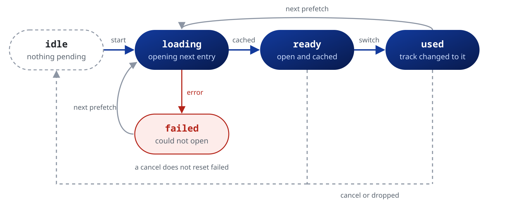

| State | Meaning |
| :--- | :--- |
| `idle` | No prefetch running (default, and after a stop) |
| `loading` | Opening the next entry and filling its cache |
| `ready` | The next entry is open and cached: the track change will use it |
| `used` | The track just started from the prefetch. Stays until the next `loading` or a cancel |
| `failed` | Opening the next entry failed (network error, unsupported codec, a hook abort). Stays until the next `loading` or a stop |

```dart
player.stream.prefetchState.listen((state) {
  if (state == PrefetchState.failed) print('Prefetch failed');
});
```

`stream.prefetchCacheDuration` tells how much of the next entry is cached, `Duration.zero` while nothing is prefetched. Divide it by your cache target for a progress bar:

```dart
player.stream.prefetchCacheDuration.listen((buffered) {
  const target = Duration(seconds: 30);
  final progress = (buffered.inMilliseconds / target.inMilliseconds).clamp(0.0, 1.0);
  showPrefetchProgress(progress);
});
```

### 9.14 Visualizer and analysis streams

See [13](#13-visualizer-waveform-and-loudness) for settings and examples.

| Stream | Type | Set with | Notes |
| :--- | :--- | :--- | :--- |
| `fft` | `FftFrame` | - | FFT bands and bins, for a bar visualizer |
| `pcm` | `PcmFrame` | - | Samples after the effects chain, for a waveform or level meter |
| `spectrum` | `SpectrumSettings` | `setSpectrum`, `updateSpectrum` | FFT and smoothing settings |
| `waveform` | `WaveformData?` | - | Envelope of the loaded track, `null` at each load until the first data |
| `loudnessScan` | `LoudnessScan?` | - | Integrated loudness, range and peaks of the loaded track |
| `loudnessMeter` | `Loudness` | - | Live readings from an `Ebur128Effect` in the chain |

### 9.15 Media session streams

See [14](#14-os-media-session).

| Stream | Type | Set with | Notes |
| :--- | :--- | :--- | :--- |
| `mediaSession` | `MediaSession?` | `setMediaSession` | The published session, or `null` |
| `mediaSessionCommands` | `MediaSessionCommand` | - | Commands from the OS (play, pause, next, seek, …). The player applies them itself; listen for logging or extra handling |

### 9.16 Event streams

These deliver only what happens after `listen()`.

| Stream | Type | Notes |
| :--- | :--- | :--- |
| `seekCompleted` | `void` | After each load or seek, once mpv is ready to play |
| `endFile` | `MpvFileEndedEvent` | Every file end, with its reason. See [11.2](#112-end-file-stream) |
| `error` | `PlayerError` | Load failures and mpv errors. See [11.1](#111-typed-error-stream) |
| `log`, `internalLog` | `MpvLogEntry` | mpv's log and the library's. See [11.4](#114-log-streams) |
| `hook` | `MpvHookEvent` | Hooks you registered. See [12.2](#122-listening-and-continuing) |

---

## 10. Raw API

For anything the typed API does not cover, talk to mpv directly. Every property and command of the [mpv manual](https://mpv.io/manual/master/) is reachable this way, except the writes to `af` and `pause` (see [10.2](#102-write-a-property) and [10.3](#103-send-a-command)).

Prefer a typed setter when one exists: it updates `state` right away, while a raw write shows up only once mpv reports the change.

### 10.1 Read a property

`getRawProperty` returns the value as a string, or `null` when the property does not exist or the read fails.

```dart
final String? codec = await player.getRawProperty('audio-codec');
final String? rate = await player.getRawProperty('audio-params/samplerate');
```

`getRawPropertyNode` returns decoded maps, lists and scalars instead of a string:

```dart
final tracks = await player.getRawPropertyNode('track-list') as List?;
```

### 10.2 Write a property

`setRawProperty` throws `MpvCommandException` when mpv rejects the write, for a typo or an out-of-range value. The exception carries `name`, `code` and `message`.

```dart
try {
  await player.setRawProperty('audio-channels', 'stereo');
} on MpvCommandException catch (e) {
  print('mpv rejected ${e.name}: ${e.message} (code=${e.code})');
}
```

`af` and `pause` belong to the player: writing them, also as `options/af` or `file-local-options/pause`, throws `ArgumentError`. Use the [effects chain](#5-audio-effects) and `play()` or `pause()` instead.

### 10.3 Send a command

`sendRawCommand` throws `MpvCommandException` when mpv rejects the command.

```dart
await player.sendRawCommand(['playlist-shuffle']);
await player.sendRawCommand(['ao-reload']);
```

These throw `ArgumentError` before reaching mpv:

- `af` and `af-command`;
- `set`, `add`, `multiply`, `cycle`, `cycle-values` and `change-list` on `af` or `pause`;
- `loadfile` with `af` or `pause` in its per-file options.

The check catches mistakes, not every way mpv offers to change a property.

---

## 11. Error handling and logging

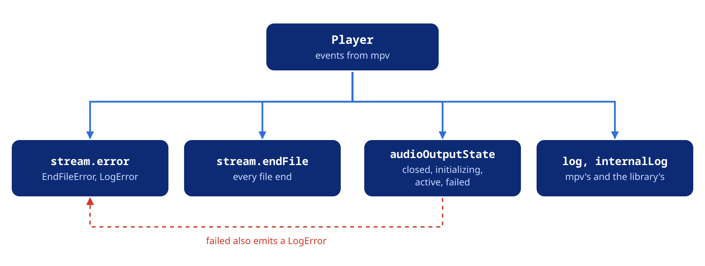

### 11.1 Typed error stream

`player.stream.error` emits a `PlayerError`, a sealed class with two subtypes:

- `EndFileError`: a file stopped because of an error.
- `LogError`: mpv logged an error or fatal message. Playback may go on.

```dart
player.stream.error.listen((error) {
  switch (error) {
    case EndFileError():
      print('File failed: ${error.reason}, code ${error.code}');
      if (error.isLoadingError) print('network or file not found');
    case LogError():
      print('mpv error: ${error.message}');
  }
});
```

| `EndFileError` | |
| :--- | :--- |
| `reason` | `MpvEndFileReason`: `eof`, `stop`, `quit`, `error` or `redirect` |
| `code` | mpv's error code, e.g. `-13` for `MPV_ERROR_LOADING_FAILED` |
| `message` | mpv's text for the error |
| `isLoadingError` | The network or the file could not be loaded |
| `isAudioOutputError` | The audio output could not be opened |
| `isFormatError` | Unknown format, or nothing to play |

| `LogError` | |
| :--- | :--- |
| `prefix` | The mpv subsystem, e.g. `ffmpeg`, `ao`, `demux` |
| `level` | `LogLevel.error` or `LogLevel.fatal` |
| `text` | The log line |
| `message` | `'[prefix] level: text'` |

### 11.2 End file stream

`player.stream.endFile` emits an `MpvFileEndedEvent` every time a file ends, not only on errors.

The event describes the entry that ended. Read it from the event, not from `player.state`, which may already describe the next entry.

| Field | |
| :--- | :--- |
| `reason` | `MpvEndFileReason` |
| `error` | mpv's error code, non-zero only when `reason` is `error` |
| `media` | The `Media` the entry was loaded with, `null` for an entry from a playlist file or a raw command |
| `position` | The last position reported for the entry, `null` if it never opened |
| `duration` | Its duration, `null` when unknown (a live stream) |
| `readError` | `true` when the entry stopped on a read error instead of at its end. `null` with a libmpv older than libmpv-r20, which cannot tell |
| `skippedSegments` | HLS and DASH segments lost to errors, `0` for other formats. `null` with a libmpv older than libmpv-r20 |

mpv reports a stream cut short, such as a dropped HTTP connection, as a normal `eof`. Use `readError` and `skippedSegments` to tell:

```dart
player.stream.endFile.listen((event) {
  if (event.readError == true || (event.skippedSegments ?? 0) > 0) {
    print('${event.media?.uri} was cut short at ${event.position}');
  }
});
```

The last entry of the playlist stays open on its end instead: `state.completed` turns true, and `state.position`, `state.readError` and `state.skippedSegments` tell how it ended. Its `endFile` event comes later, with `reason: stop`, when it is stopped or replaced.

```dart
player.stream.completed.listen((completed) {
  if (completed && player.state.readError == true) {
    print('The last track was cut short at ${player.state.position}');
  }
});
```

Good to know:

- A dropped connection is first retried ([7.9](#79-dropped-connections)). It counts as a read error only once every retry has failed.
- A seek after a cut reads again. If the server answers, the entry plays on.
- With gapless playback, an entry ends when its decoder is done, so `position` can trail the end by the [audio buffer](#610-audio-buffer).
- `duration` can be an estimate (an MP3 without a Xing or VBRI header, some HLS streams): comparing it with `position` does not reliably detect a cut.

### 11.3 Audio output lifecycle

`player.stream.audioOutputState` follows the audio output, so you can notice a silent player.

```dart
player.stream.audioOutputState.listen((state) {
  switch (state) {
    case AudioOutputState.closed:       // no output open
    case AudioOutputState.initializing: // opening, rarely seen
    case AudioOutputState.active:       // open and playing
    case AudioOutputState.failed:       // no output could be opened
  }
});
```

When no device can be opened, mpv usually falls back to its null output: the state is `active`, the position runs and nothing is heard. `stream.error` then emits a `LogError`, unless you chose the null driver yourself with `setAudioDriver('null')`.

`failed` only comes when even the null output cannot open. `stream.error` emits a `LogError` then too, and each file that cannot play ends with an `EndFileError` whose `isAudioOutputError` is `true`.

### 11.4 Log streams

- `player.stream.log`: mpv's messages (`ffmpeg`, `demux`, `ao`, `cplayer` and so on).
- `player.stream.internalLog`: the library's own messages, such as hook timeouts and resolver errors, with the prefix `mpv_audio_kit`.

Keeping them apart lets you route them to different places, for example `log` to a debug overlay and `internalLog` to crash reporting.

```dart
player.stream.log.listen((entry) {
  if (entry.level == LogLevel.error || entry.level == LogLevel.fatal) {
    print('[${entry.level.mpvValue}] ${entry.prefix}: ${entry.text}');
  }
});

player.stream.internalLog.listen((entry) {
  print('[mpv_audio_kit:${entry.level.mpvValue}] ${entry.text}');
});
```

`PlayerConfiguration.logLevel` sets the starting level (`LogLevel.warn` by default). `setLogLevel` changes it at any time:

```dart
player.setLogLevel(LogLevel.debug); // while developing
player.setLogLevel(LogLevel.off);   // silence mpv
```

### 11.5 Exceptions

A call that fails throws a `PlayerException`, a sealed class:

| Exception | When |
| :--- | :--- |
| `PlayerDisposedException` | The player was disposed |
| `PlayerInitException` | libmpv could not load or start. Every call on that player throws it, with the reason in `message` |
| `MpvCommandException` | mpv rejected the request, such as a seek with no file loaded. Carries `name`, `code` and `message` |
| `SourceException` | A source could not be prepared, such as a missing `asset://` or an unreadable `content://` |

```dart
try {
  await player.seek(position);
} on PlayerException catch (e) {
  switch (e) {
    case PlayerDisposedException():
      break;
    case PlayerInitException(:final message):
      print('libmpv did not start: $message');
    case MpvCommandException(:final name, :final message):
      print('$name rejected: $message');
    case SourceException(:final uri):
      print('Cannot open $uri');
  }
}
```

Invalid arguments, such as a negative volume or a playlist index out of range, throw `ArgumentError` or `RangeError` before anything reaches mpv.

`next()` and `previous()` do not throw when there is no track to go to: they return `false`.

---

## 12. Hooks

A hook pauses mpv at one step of loading a file until your code says to go on. Use it to resolve a URL at the last moment, add headers for one file or switch to another source, with no local proxy.

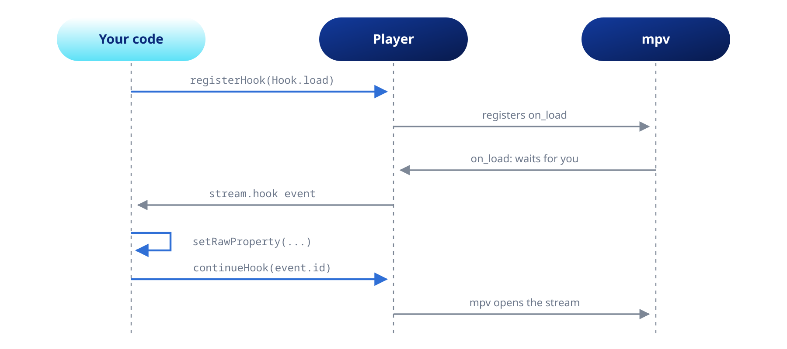

You may not need a hook at all:

- Headers only: pass them in [`Media.httpHeaders`](#22-http-headers).
- URL resolution: [`setSourceResolver`](#124-the-source-resolver) does the hook work for you.

### 12.1 Registering a hook

Call `registerHook` after creating the player, and await it before the first `open`:

```dart
await player.registerHook(Hook.load);
```

With a `timeout`, the library continues the hook itself if your code has not, for example after an unhandled exception:

```dart
await player.registerHook(Hook.load, timeout: const Duration(seconds: 10));
```

| Hook | When it fires |
| :--- | :--- |
| `Hook.beforeStartFile` | Before any work on the file begins |
| `Hook.load` | Before the stream opens. Change the URL or add headers for this file |
| `Hook.loadFail` | After the stream failed to open. Try a fallback URL |
| `Hook.preloaded` | File open, before tracks are selected and decoding starts |
| `Hook.unload` | Before the file closes |
| `Hook.afterEndFile` | After the file ended and was unloaded |
| `Hook.prefetch` | Before the next entry opens ahead of time, while the current one plays |

**Prefetch.** With `setPrefetchPlaylist(true)`, mpv opens the next entry early and runs `Hook.prefetch` for it:

- Read `prefetch-open-filename` for the URL it will open, and write it to open another one. `prefetch-playlist-entry-id` names the entry.
- When the entry starts, `Hook.load` runs with the entry's original URL in `stream-open-filename`. Write the same URL you gave in the prefetch, or mpv drops the early stream and opens the entry again.
- Other properties, such as `path`, `stream-open-filename` and `file-local-options/...`, still belong to the entry that is playing.
- If the current entry ends, or the next entry changes, before you continue the hook, mpv drops the early open.

The [source resolver](#124-the-source-resolver) handles all of this for you.

### 12.2 Listening and continuing

Listen to `player.stream.hook` and call `continueHook` when you are done. Call it on every path, errors included: until you do, mpv waits.

```dart
player.stream.hook.listen((event) async {
  try {
    if (event.hook == Hook.load) {
      final url = await player.getRawProperty('stream-open-filename') ?? '';
      if (url.startsWith('my-scheme://')) {
        final resolved = await myResolver(url);
        await player.setRawProperty('stream-open-filename', resolved.url);
      }
    }
  } finally {
    player.continueHook(event.id);
  }
});
```

### 12.3 HTTP headers via hook

Inside a hook, `file-local-options/http-header-fields` sets headers for the current file only. For HLS they reach the playlist and every segment, as with `Media.httpHeaders`.

```dart
await player.setRawProperty(
  'file-local-options/http-header-fields',
  'Authorization: Bearer abc123',
);
```

Separate several headers with commas. During `Hook.prefetch` the current file is the one still playing, so per-entry headers are safer in `Media.httpHeaders`.

### 12.4 The source resolver

`setSourceResolver` resolves the URL of each entry right before it opens, in one callback. No `registerHook` or `continueHook` needed.

The resolver gets the entry's original `Media`, with its `extras` and `httpHeaders`, and returns the URL to play:

```dart
await player.setSourceResolver((request) async {
  final id = request.media.extras?['trackId'] as String?;
  if (id == null) return null;         // not ours: keep the URL
  return service.getPlaybackUrl(id);   // temporary CDN or token URL
});

// Queue by id. No network calls until each track opens.
await player.openAll([
  Media('resolve://1', extras: {'trackId': '1'}),
  Media('resolve://2', extras: {'trackId': '2'}),
]);
```

When it runs:

- before every stream opens (`on_load`), and before the next entry opens ahead of time (`on_prefetch`);
- once more after a failed open (`on_load_fail`), with `request.isRetry` set. Return a fresh URL, for example with a new token, and mpv tries again. This happens at most once per load, and only if the new URL differs.

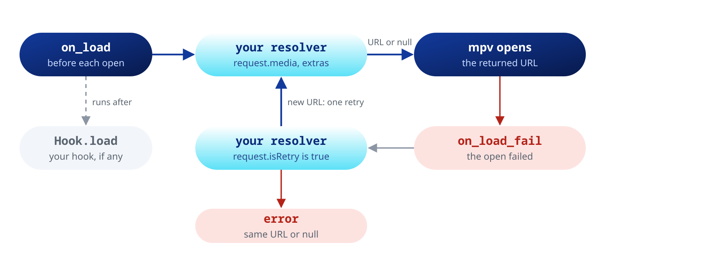

What it returns:

- `null`, or `request.uri` unchanged: the URL stays as it is.
- A thrown error: logged on `internalLog`, the URL stays as it is.
- A `file://` URL: plays as the local path it names.

Good to know:

- `timeout` (default 15 s) cuts off a resolver that hangs, and the load goes on. A URL returned after that is dropped. `timeout: null` removes the limit.
- Your own `Hook.load` or `Hook.prefetch` listener still works: the resolver runs first, then your listener gets the event and calls `continueHook`.
- With prefetch on, the URL resolved for the prefetch is reused when the entry starts, so a URL that changes on every call (a signed URL) keeps the gapless change. A resolver slower than the rest of the playing track misses the prefetch and is asked again when the entry opens.
- `setSourceResolver(null)` removes the resolver.

### 12.5 Lazy URL resolution

Some servers refuse parallel sessions, as Plex does for transcoding. If you build a playlist by resolving every track at once, the calls overlap.

Instead, queue placeholder URLs such as `my-scheme://session-id`, register `Hook.load` and resolve each one in its listener ([12.2](#122-listening-and-continuing)). mpv opens tracks one at a time, so the calls never overlap:

```dart
// No server calls yet: each Media holds a placeholder
await player.openAll([
  for (final t in tracks) Media('my-scheme://${t.id}'),
]);

// When mpv reaches a track, the Hook.load listener calls
// myResolver('my-scheme://<id>'), which asks the server for the stream
```

The [source resolver](#124-the-source-resolver) does the same with less code.

---

## 13. Visualizer, waveform and loudness

`player.stream.fft` and `player.stream.pcm` carry the audio going to the output, after the effects chain and the volume: what you hear.

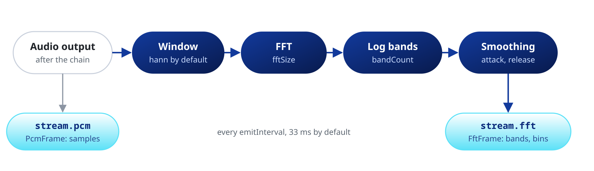

There is nothing to turn on. Every stream in this chapter (`fft`, `pcm`, `tap`, `waveform`, `loudnessScan`, `loudnessMeter`) starts working on the first `listen()` and stops on the last cancel.

With several players, the analysis is shared by the whole process: `fft`, `pcm` and the taps show the audio the last output wrote, and `waveform` and `loudnessScan` follow the last file opened.

### 13.1 Subscribing to the spectrum stream

`player.stream.fft` emits an `FftFrame` 30 times a second by default.

```dart
player.stream.fft.listen((frame) {
  for (var i = 0; i < frame.bands.length; i++) {
    final h = frame.bands[i] * canvasHeight;
    // draw bar i with height h
  }
});
```

| Field | Type | What it is |
| :--- | :--- | :--- |
| `bands` | `Float32List` | Smoothed, log-spaced bands from 0 to 1, for a bar visualizer. Length `bandCount` |
| `bins` | `Float32List` | Raw magnitude per linear-frequency bin, from 0 to 1. Length `fftSize / 2` |
| `timestamp` | `Duration` | Engine clock when the samples were captured. Not the track position |
| `sampleRate` | `int` | Output sample rate, in Hz |
| `bandLowHz`, `bandHighHz` | `double` | Edges of the band axis |

Paint `bands` as they come: they rise fast and fall slowly, so bars move smoothly with no animation code. Use `bins` for your own mapping (mel, Bark, peak detection).

While playback is paused no frames arrive and the last one stays. To fade the bars on pause, animate them yourself.

### 13.2 Configuring the pipeline

`setSpectrum` applies a `SpectrumSettings`, and `updateSpectrum` changes one field:

```dart
// 60 frames a second, 128 bands, a narrower dB window
player.setSpectrum(const SpectrumSettings(
  bandCount: 128,
  emitInterval: Duration(milliseconds: 16),
  minDb: -90,
  maxDb: -20,
));

// Change one field, e.g. from a slider
player.updateSpectrum((s) => s.copyWith(attackSmoothing: 0.7));
```

| Field | Default | Range or choice |
| :--- | :--- | :--- |
| `fftSize` | 2048 | Power of 2 from 256 to 4096 |
| `bandCount` | 64 | Typically 32 to 128 |
| `bandLowHz` | 20 | Lowest band edge, in Hz |
| `bandHighHz` | 20000 | Highest band edge, capped at half the sample rate |
| `window` | `WindowFunction.hann` | `hann`, `blackmanHarris`, `rectangular` |
| `emitInterval` | 33 ms | 8 to 67 ms (about 120 to 15 frames a second) |
| `attackSmoothing` | 0.5 | 0 to 1, while a band rises. Higher reacts faster |
| `releaseSmoothing` | 0.1 | 0 to 1, while a band falls. Lower decays slower |
| `minDb`, `maxDb` | -100, -30 | dB range mapped to 0 to 1 |
| `overlapFactor` | 4 | Power of 2 from 1 to 16 |

### 13.3 Raw PCM stream

`player.stream.pcm` emits a `PcmFrame` at the same rate as `fft`, with the samples instead of the spectrum. Use it for an oscilloscope, a level meter or your own analysis.

```dart
double peak = 0;
player.stream.pcm.listen((frame) {
  for (final s in frame.samples) {
    if (s.abs() > peak) peak = s.abs();
  }
  peak *= 0.92; // decay
  vuController.value = peak;
});
```

`samples` is a `Float32List` with the channels interleaved (`L, R, L, R`). `samplesPerChannel` gives the count per channel.

Consecutive frames overlap, so a scrolling display should draw only the samples it has not drawn yet.

### 13.4 Per-filter PCM taps

`player.stream.tap(filter, side: ...)` captures the samples before (`TapSide.pre`) or after (`TapSide.post`) one stage of the effects chain:

```dart
player.stream
    .tap(AudioFilter.equalizer, side: TapSide.pre)
    .listen((pcm) => paintInputWaveform(pcm.samples));
player.stream
    .tap(AudioFilter.equalizer, side: TapSide.post)
    .listen((pcm) => paintOutputWaveform(pcm.samples));
```

- `filter` names the stage by its `AudioFilter`.
- `instance` picks which one when the filter appears more than once (0, the default, is the first). Disabled stages count too, and emit nothing.
- Up to eight stages can be tapped at once, across all players.

For bands, run the samples through a `BandProcessor`. It uses the same FFT and smoothing as `stream.fft`:

```dart
final processor = BandProcessor(player.state.spectrum);
player.stream.spectrum.listen(processor.setSettings);
player.stream
    .tap(AudioFilter.equalizer, side: TapSide.post)
    .listen((pcm) {
      final fft = processor.process(pcm);
      if (fft != null) painter.bands = fft.bands;
    });
```

Every typed stage exposes its `filter`, so you can tap the whole chain:

```dart
final seen = <AudioFilter, int>{};
for (final e in player.state.audioEffects) {
  final f = e.filter;
  if (f == null) continue; // raw stage
  final instance = seen.update(f, (n) => n + 1, ifAbsent: () => 0);
  if (!e.enabled) continue; // counts, but has nothing to tap
  player.stream.tap(f, instance: instance, side: TapSide.post).listen(_paint);
}
```

### 13.5 Waveform

`player.stream.waveform` emits a mono envelope of the loaded track: about 2000 bins, each with its min, max and RMS. Use it for a waveform overview or a waveform seekbar.

```dart
player.stream.waveform.listen((wave) {
  if (wave == null) return; // null at each file load
  for (var i = 0; i < wave.bins; i++) {
    if (wave.filled[i] == 0) continue; // no data yet: draw a baseline
    // light bar from wave.min[i] to wave.max[i] (range -1 to 1)
    // solid bar from -wave.rms![i] to wave.rms![i] (range 0 to 1)
  }
});
```

How it fills depends on the source:

| Source | Envelope |
| :--- | :--- |
| Local file | Decoded ahead of time. Partial envelopes arrive with `decoding` true, then the final one |
| HTTP file played from its start | Decoded from mpv's cache as it downloads |
| Transcode with no length | As above, when its `Media` gives the track length in `waveformDurationHint` |
| Adaptive, non-seekable or other transcoded streams | Fills in as playback advances |
| Live stream | A rolling window, with `live` true |

- `filled` has one byte per bin, `1` once the bin holds data.
- Bin `i` covers `start + duration * i / bins` to `start + duration * (i + 1) / bins`.
- On loud, heavily limited masters, draw `rms` as the body and min and max as a lighter outline to keep the sections readable.

A network file is downloaded only once: the analysis reads mpv's cache. When that is not possible (a seek past the cache, a file larger than the cache, the cache off), it opens the source a second time with the same network options as playback.

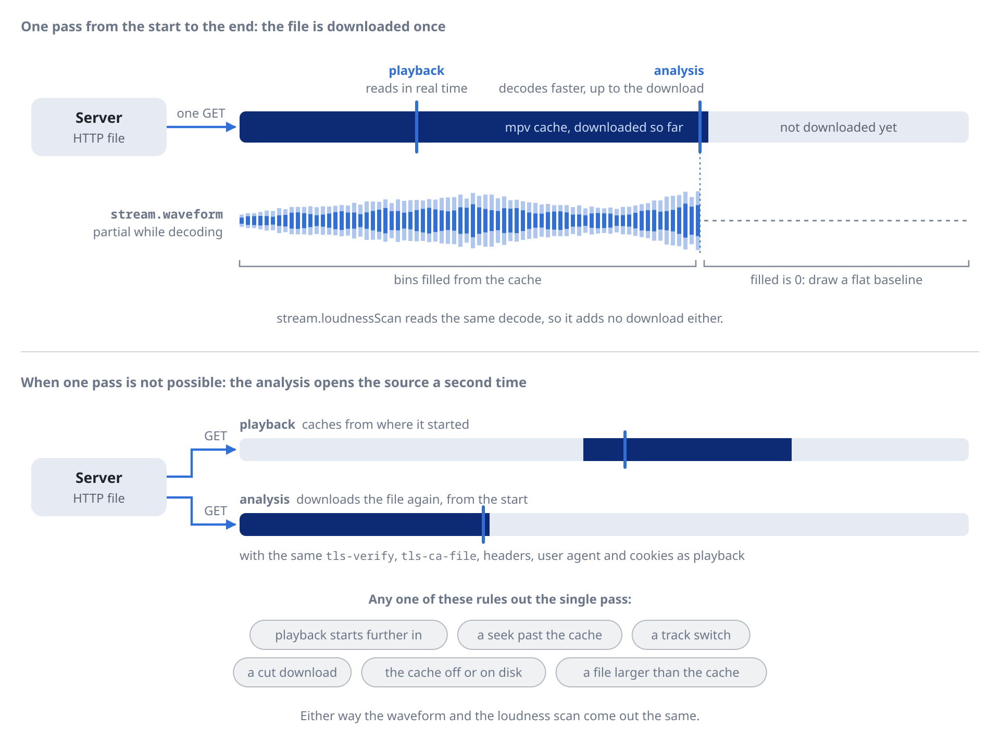

The analysis reads the audio track the player plays, Android `content://` sources included. With an external track (`addAudioTrack`), the waveform fills from playback.

### 13.6 Loudness

`player.stream.loudnessScan` measures the EBU R128 loudness of the loaded track. Like the waveform, it decodes the file apart from playback, many times faster than real time.

While it runs, it emits `scanning` snapshots with `progress`. Then it emits one final `LoudnessScan` with integrated LUFS, loudness range, sample peak and true peak, often before the audio starts.

Use it to level files without ReplayGain tags:

```dart
player.stream.loudnessScan.listen((scan) {
  if (scan?.state == LoudnessScanState.ready) {
    // ReplayGain 2.0 reference is -18 LUFS
    player.setVolumeGain((-18.0 - scan!.integrated!).clamp(-24.0, 24.0));
  }
});
```

- The stream emits `null` each time a file loads.
- Streams that can only be decoded as they play (adaptive, live, or an external audio track) report `LoudnessScanState.unavailable`: use the live meter below.
- The scan is shared by all players, so the example assumes one player.

### 13.7 Live loudness meter

`player.stream.loudnessMeter` emits momentary, short-term, integrated and range readings of the audio as it plays.

It reads the first enabled `Ebur128Effect` in the chain with `metadata: true`. Add one where you want to measure; without it the stream emits nothing.

```dart
await player.updateAudioEffects(
  (fx) => [...fx, const Ebur128Effect(metadata: true)],
);
player.stream.loudnessMeter.listen((l) => meter.paint(l.momentary));
```

- `momentary` and `shortTerm` sit at about -120.7 LUFS until their window fills and during silence: clamp them to your scale.
- `integrated` starts at -70 LUFS and `range` at 0 LU.
- The meter restarts at every seek, loop, track change and output reopen. For the loudness of a whole track, use the [scan](#136-loudness).

---

## 14. OS media session

`setMediaSession` publishes the player to the system media controls and applies the commands they send back.

| Platform | Controls |
| :--- | :--- |
| iOS, macOS | Now Playing, Control Center, lock screen |
| Android | Media notification |
| Windows | SMTC |
| Linux | MPRIS |
| Web | `navigator.mediaSession` ([15.5](#155-what-differs-on-the-web)) |

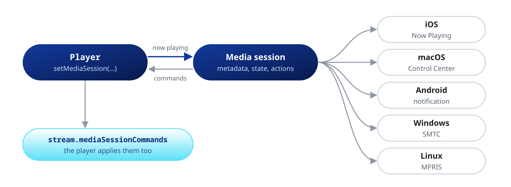

Rules:

- One `Player` per process owns the session. Enabling a second throws `StateError`, also from another Flutter engine of the process (add-to-app, a second window).
- The owner keeps it until it passes `null`, is disposed or loses its engine. `dispose()` releases it for you.
- Only a `Player` of the root isolate can publish: elsewhere it throws `StateError`.

### 14.1 Enabling the session

Title, artist, album, artwork and duration come from the playing file:

```dart
await player.setMediaSession(const MediaSession()); // enable
await player.setMediaSession(null);                 // remove
```

### 14.2 Overriding metadata

`title`, `artist`, `album` and `duration` override the file: `null` keeps the file's value, a string replaces it, and an empty string leaves it blank.

```dart
await player.setMediaSession(
  (player.state.mediaSession ?? const MediaSession())
      .copyWith(title: 'Custom title', artist: 'Custom artist'),
);
```

For a file without tags, such as a transcoded stream, each field falls back to the entry's `Media.extras`:

- `title`, `artist` and `album`, as strings;
- `art`, a cover URL used when the artwork is `embedded` and the file has none.

With no title anywhere, the session shows mpv's `media-title`, taken from the URL.

### 14.3 Artwork and privacy

`MediaSession.artwork` picks the image:

```dart
MediaSessionArtwork.embedded               // default: the file's cover
MediaSessionArtwork.custom(myCoverArt)     // your own CoverArt
MediaSessionArtwork.uri(Uri.parse(artUrl)) // an image the package loads
MediaSessionArtwork.none                   // no artwork
```

Cover URLs often carry credentials (Subsonic, Jellyfin, Plex), so on native platforms a network URL never reaches the OS as text: the package downloads the image and hands the OS the bytes. On the web, a cover the page cannot download (no CORS) goes to the browser as a URL, and the browser loads it itself.

The download:

- always verifies the server certificate, even with `tls-verify` off, and trusts `tls-ca-file` on top of the system roots;
- refuses a redirect from `https` to `http`;
- skips images over 20 MB and gives up after 3 attempts.

Supported cover URLs:

| Scheme | Where |
| :--- | :--- |
| `http://`, `https://`, `file://` | Every platform |
| `asset:///assets/cover.png` | Every platform and the web. Use three slashes: a `Uri` lowercases what follows two |
| `content://`, `android.resource://` | Android. Must be an image (PNG, JPEG, GIF, WebP, BMP, HEIF or AVIF) |
| `blob:` | The web |

Any other scheme, such as `ms-appx://`, shows no artwork: load the bytes yourself and use `MediaSessionArtwork.custom`. The same goes for covers that need custom headers.

A `Uri` also lowercases an Android authority. For one with capitals, pass the URL as a string in `extras['art']`.

### 14.4 Reacting to OS commands

The player applies OS commands itself: play on the lock screen calls `play()`, scrubbing calls `seek()`, and so on. It also emits them on `player.stream.mediaSessionCommands`:

```dart
player.stream.mediaSessionCommands.listen((command) {
  switch (command) {
    case MediaSessionCommandSeekTo(:final position):
      log('Scrubbed to $position');
    case MediaSessionCommandNext():
      // With a single-track playlist, next and previous only emit here:
      // advance your own queue.
      myQueue.next();
    case _:
      break;
  }
});
```

### 14.5 Capabilities, intervals and speeds

`actions` lists the controls the OS may show. The default is `play`, `pause`, `playPause`, `next`, `previous` and `seek`.

Also available: `stop`, `fastForward`, `rewind`, `setRepeatMode`, `setShuffle`, `setPlaybackRate` and `like` (a favorite button, with `isFavorite` for its state).

```dart
const MediaSession(
  actions: {
    MediaAction.play, MediaAction.pause, MediaAction.playPause,
    MediaAction.next, MediaAction.previous, MediaAction.seek,
    MediaAction.fastForward, MediaAction.rewind, MediaAction.setPlaybackRate,
  },
  fastForwardInterval: Duration(seconds: 30), // default 15 s
  rewindInterval: Duration(seconds: 15),
  supportedPlaybackRates: [1.0, 1.25, 1.5, 2.0],
  autoApplyPlaylistNavigation: false,
);
```

- The skip intervals and the speed list apply only when their action is in the set.
- With `autoApplyPlaylistNavigation: false`, next and previous no longer change track. Handle them on [`stream.mediaSessionCommands`](#915-media-session-streams), for example as a 30 s skip in an audiobook.

Each platform draws only some actions, and a lock screen usually shows 3 or 4. An action a platform does not draw is simply left out:

| Action | iOS | macOS | Android | Windows | Linux |
|---|:--:|:--:|:--:|:--:|:--:|
| `play`, `pause`, `playPause` | Yes | Yes | Yes | Yes | Yes |
| `next`, `previous` | Yes | Yes | Yes | Yes | Yes |
| `seek` (scrubber) | Yes | Yes | Yes | Yes | KDE |
| `fastForward`, `rewind` | Yes | Yes | Yes | Yes | No |
| `stop` | No | No | No | Yes | No |
| `setRepeatMode`, `setShuffle` | No | No | Yes | No | KDE |
| `setPlaybackRate` | No | No | No | No | KDE |
| `like` | Yes | No | Yes | No | No |

- Linux depends on the desktop: KDE Plasma draws seek, repeat, shuffle and rate, while GNOME shows only previous, play-pause and next.
- Windows stores repeat, shuffle and rate, but its flyout has no button for them.

### 14.6 Audio interruptions

`interruptionPolicy` decides what happens on a phone call, Siri, or another app taking the audio focus:

```dart
InterruptionPolicy.pauseAndResume // default: pause, resume when the OS allows
InterruptionPolicy.pauseOnly      // pause, never resume on its own
InterruptionPolicy.keepPlaying    // keep playing at full volume
```

- It applies on iOS and Android. macOS, Linux and Windows have no per-app audio session.
- `keepPlaying` has OS limits: on iOS an accepted call or Siri still takes the audio, and on Android 12 and later the system may fade the app out.
- Unplugging headphones always pauses.
- On iOS the player's audio does not mix with other apps, and the output opens as soon as a file loads: even `open(media, play: false)` stops another app's audio.
- When another app asks to duck (a navigation prompt), Android 8 and later lower the volume; Android 7 keeps it at full volume.

Background playback needs some setup: see [Permissions](#permissions) for [iOS](#ios) and [Android](#android).

### 14.7 App identity (desktop)

On Linux (MPRIS) and Windows (SMTC) the controls show your app's name. macOS, iOS and Android take it from the app bundle and ignore these fields.

```dart
const MediaSession(
  appName: 'My Player',              // shown by MPRIS and SMTC
  desktopEntry: 'com.example.myapp', // Linux only
);
```

`desktopEntry` is the name, without `.desktop`, of the file you install in `/usr/share/applications/`. Linux uses it to find the icon shown beside the controls. On Windows the icon comes from the executable.

---

## 15. Web

The same `Player` runs on Flutter Web, with libmpv built as WebAssembly. Effects, taps, waveform, loudness, hooks, playlists and live PCM input work as on the other platforms, with the same app code.

### 15.1 Serving the page

libmpv runs on threads, so the page must be cross-origin isolated. Every response needs these headers:

```
Cross-Origin-Opener-Policy: same-origin
Cross-Origin-Embedder-Policy: credentialless
```

Safari supports only `require-corp` for the second header. Then every cross-origin resource loaded without CORS (an image, a font) needs a `Cross-Origin-Resource-Policy` header.

| Where | How |
| :--- | :--- |
| Development | `flutter run -d chrome --wasm --cross-origin-isolation` |
| Cloudflare Pages, Netlify | A `web/_headers` file with the two headers under `/*` |
| GitHub Pages | A service worker such as coi-serviceworker, plus a `web/flutter_bootstrap.js` that calls `_flutter.loader.load()` without `serviceWorkerSettings`, so Flutter's own worker does not replace it. [mpv_studio](https://github.com/ales-drnz/mpv_studio) does both in its `web/` folder |

When the page is not a secure, cross-origin isolated one, or the browser lacks SharedArrayBuffer or AudioWorklet, libmpv cannot run and there is no fallback.

`MpvAudioKit.unsupportedReason` names what is missing, or is `null` when nothing is (always `null` outside the web). A `Player` then fails with a `PlayerInitException` that says the same. Read it first to show your own message.

The package ships libmpv as web assets (`libmpv.mjs`, `libmpv.wasm`, `mak_webaudio_processor.js`), served at `assets/packages/mpv_audio_kit/web/`. A git checkout gets them with `scripts/update_libmpv.sh`.

To load another build, pass the URL of its `libmpv.mjs`, with `libmpv.wasm` and `mak_webaudio_processor.js` beside it, all on the page's origin:

```dart
MpvAudioKit.ensureInitialized(libmpv: '/mpv/libmpv.mjs');
```

The module loads in the background from `ensureInitialized` on; the first `Player` waits for it.

### 15.2 Sound and the autoplay policy

Browsers hold a page's sound until the user interacts with it. The first click, tap or key press starts it, as does `Player.play()` called from one.

Until then a playing player waits at its position, and `MpvAudioKit.needsUserGesture` is true (always false outside the web):

```dart
StreamBuilder<bool>(
  stream: MpvAudioKit.needsUserGestureStream,
  initialData: MpvAudioKit.needsUserGesture,
  builder: (context, snapshot) => snapshot.data!
      ? const Text('Tap anywhere to start the sound')
      : const SizedBox.shrink(),
);
```

### 15.3 Files the user picks

`Media.fromBlob` plays a browser `File` or `Blob`: from an `<input type="file">`, a drop, or a folder opened with `showDirectoryPicker`.

```dart
import 'dart:js_interop';
import 'package:web/web.dart' as web;

final input = web.HTMLInputElement()
  ..type = 'file'
  ..accept = 'audio/*'
  ..multiple = true;
input.onchange = (web.Event _) {
  final files = input.files!;
  player.openAll([
    for (var i = 0; i < files.length; i++) Media.fromBlob(files.item(i)!),
  ]);
}.toJS;
input.click();
```

- The media gets the file's name as its `title` extra.
- The file can sit on a network share the system has mounted (SMB, NFS): the browser reads it through the system.
- A `blob:` URL you already have, such as the `path` of an `XFile` from file_selector, plays as `Media(url)`.
- `asset:///` sources load from the page's origin.

### 15.4 Network

libmpv reads `http` and `https` through the browser's fetch, HLS and DASH segments included.

- **CORS**: a server of another origin must send `Access-Control-Allow-Origin`, or the file does not open. For other servers, use a proxy on the page's origin, reached through a [`SourceResolver`](#124-the-source-resolver).
- **Seeking** needs a server that answers range requests with 206.
- **Mixed content**: a page served over `https` cannot open `http://` URLs, local network servers included. Only `localhost` is exempt.
- **ICY titles** work for a radio on the page's origin. For another origin, pass `streamLavfOptions: {'icy_cross_origin': '1'}` on its `Media`; this needs a server that accepts the `Icy-MetaData` header and exposes `icy-metaint` through CORS.
- **TLS, cookies, proxies** are the browser's: `setTlsVerify`, `setTlsCaFile`, `setCookies` and `setHttpProxy` have no effect, and headers fetch forbids (`Cookie`, `Referer`, `Host`) are not sent.
- **SMB**: `smb2://` is not available. Mount the share in the system and pick its files ([15.3](#153-files-the-user-picks)).

### 15.5 What differs on the web

| Feature | On the web |
| :--- | :--- |
| `setSystemVolume`, `setSystemMute` | The gain of the player's output, after effects and taps |
| `setAudioSampleRate` | Recreates the page's audio output at that rate, for every player of the page |
| Output devices | One: the page's output |
| File paths, `file://`, `content://` | Not available: pick files ([15.3](#153-files-the-user-picks)) |
| `PcmSource.create` | Needs the module loaded: call it once a player is ready, or use `Player.openPcmStream`, which waits |
| OS media session | `navigator.mediaSession`, with play, pause, stop, next, previous, seek and skip. While it is on, the sound plays through an `<audio>` element, which browsers want before they show their controls |
| Hot restart | Destroys the players the previous run left and reuses the loaded module |

---

## Permissions

### Android

Network sources need, in your app's manifest:

```xml
<uses-permission android:name="android.permission.INTERNET" />
```

The package already declares `FOREGROUND_SERVICE`, `FOREGROUND_SERVICE_MEDIA_PLAYBACK` and `POST_NOTIFICATIONS`. You do not need to request `POST_NOTIFICATIONS` at runtime: media notifications are exempt.

**Background playback** needs the [media session](#14-os-media-session). `setMediaSession` runs a foreground service of type `mediaPlayback`, which keeps the app alive after the user leaves it. Without a session, Android may freeze or stop the app in the background.

- After 10 minutes in pause, the service leaves the foreground and Android may stop the app. A pause caused by a phone call under `pauseAndResume` does not count.
- If Android refuses the foreground service to a play started in the background, the player pauses.
- The player takes no wake lock. If a network stall pauses the output with the screen off, the device may sleep until something wakes it.
- Back from the root route, or a swipe from the recent apps, can destroy the Flutter engine and stop its players (see [1.3](#13-disposing-a-player)).

### iOS

For background playback, add the Background Modes capability in Signing & Capabilities and check `Audio, AirPlay, and Picture in Picture`. This writes to `Info.plist`:

```xml
<key>UIBackgroundModes</key>
<array>
  <string>audio</string>
</array>
```

### macOS

For network sources, add to `DebugProfile.entitlements` and `Release.entitlements`:

```xml
<key>com.apple.security.network.client</key>
<true/>
```

---

## Troubleshooting

### Building and testing in containers (WSL, Docker or Distrobox)

libmpv comes prebuilt, so building needs only the Flutter desktop tools. At runtime libmpv needs `libasound2`, and a PipeWire (0.3.57 or later) or PulseAudio client to reach the host's sound server. Desktop distributions ship them; a minimal container does not:

```bash
sudo apt update

# Flutter desktop build tools
sudo apt install clang cmake ninja-build pkg-config libgtk-3-dev liblzma-dev

# Runtime libraries to play sound through the host
sudo apt install libasound2 libpipewire-0.3-0 libpulse0
```

Inside a container the `alsa` driver cannot reach the sound card: use `pipewire` or `pulse` ([6.1](#61-audio-output-driver)). On WSL only `pulse` works.

---

## Project background

I wrote the native bindings, the isolate code and most of the architecture with Claude Code.

Jellyfin, Plex and Samba are trademarks of their respective owners. mpv_audio_kit is not affiliated with them.

---

*Developed by Alessandro Di Ronza*
