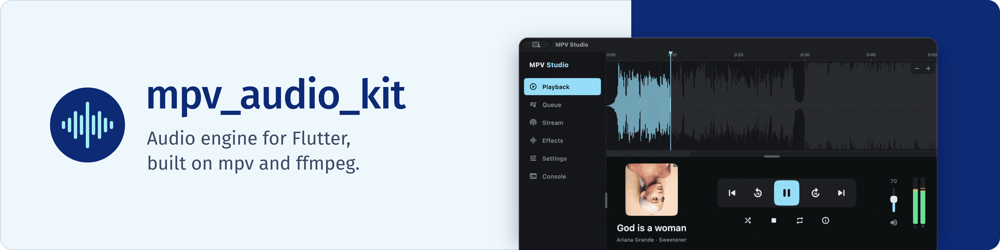
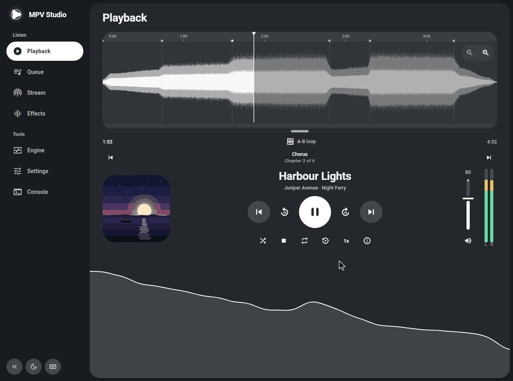
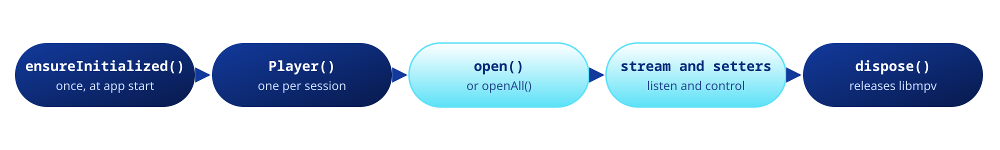
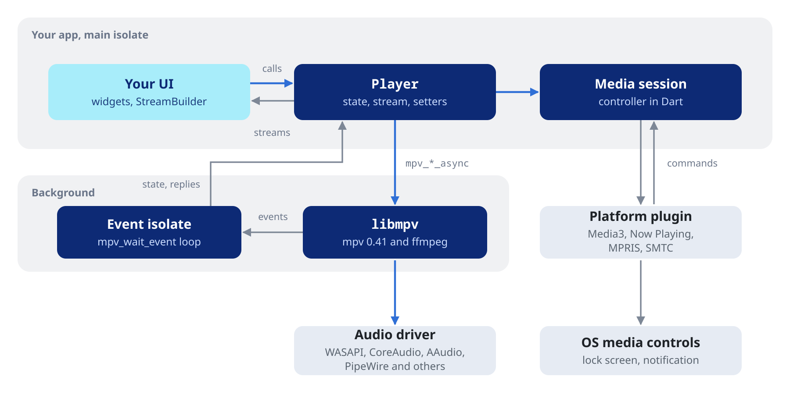

<p align="center">

</p>

# mpv_audio_kit

#### Audio engine for Flutter.

[](https://pub.dev/packages/mpv_audio_kit)
[](https://github.com/ales-drnz/libmpv-scripts)
[](LICENSE)
[](https://github.com/ales-drnz/mpv_audio_kit)
[](https://discord.gg/g2Qf4Mq9MP)
[](https://www.patreon.com/cw/ales_drnz)
[](https://www.buymeacoffee.com/ales.drnz)

---

## Made for your media library

The package is an audio player for Flutter apps that play a media library, from a server or from the device. It runs mpv and FFmpeg behind a typed Dart API, on Android, iOS, macOS, Windows, Linux and the web.

<table>
<tr>
<td valign="middle" width="80"><a href="https://ales-drnz.github.io/mpv_studio/"></a></td>
<td valign="middle"><b><a href="https://ales-drnz.github.io/mpv_studio/">Try MPV Studio in your browser</a></b><br>The demo app runs the package with libmpv as WebAssembly. Its source is in the <a href="https://github.com/ales-drnz/mpv_studio">mpv_studio</a> repository.</td>
</tr>
</table>

<table>
<tr>
<td valign="middle" width="48"></td>
<td valign="middle"><b>Jellyfin</b><br>Stream your library directly or transcoded. Transcoded streams arrive as HLS, and you can still seek in them.</td>
</tr>
<tr>
<td valign="middle"></td>
<td valign="middle"><b>Plex</b><br>Play tracks and playlists over HLS or DASH. Each entry asks the server for its stream only when it opens, so a long queue starts at once.</td>
</tr>
<tr>
<td valign="middle"></td>
<td valign="middle"><b>Samba</b><br>Play straight from a NAS or any network share over SMB2 and SMB3.</td>
</tr>
<tr>
<td valign="middle"></td>
<td valign="middle"><b>Tuning and analysis</b><br>Tune the cache and the network, shape the sound with <a href="https://pub.dev/documentation/mpv_audio_kit/latest/topics/Effects-topic.html">a chain of FFmpeg effects</a>, and watch it with a live spectrum, waveform and loudness meter.</td>
</tr>
</table>

<p align="center">
  
</p>

---

## Getting started

```yaml
dependencies:
  mpv_audio_kit: ^0.6.3
```

The build downloads the libmpv binary for each native target and checks its SHA-256, so the first build needs network access. On the web the module ships with the package.

| Platform | Minimum | Architectures | Size |
| :--- | :--- | :--- | :---: |
| Android | 7.0 (SDK 24) | arm64-v8a, armeabi-v7a, x86_64 | 7.7 to 8.3 MB per ABI |
| iOS | 15.0 | arm64, simulator arm64 and x86_64 | 7.3 MB |
| macOS | 12.0 | arm64, x86_64 | 15.1 MB universal |
| tvOS | 15.0 | arm64, simulator arm64 and x86_64 | 7.3 MB |
| Windows | 10 | arm64, x86_64 | 7.8 MB |
| Linux | glibc 2.31 | aarch64, x86_64 | 8.4 MB |
| Web | a cross-origin isolated page | wasm32 | 4.3 MB, 2.0 MB zipped |

The package needs Flutter 3.41 or later, and Flutter 3.47.4 to build for iOS. Linux needs ALSA, and uses PipeWire or PulseAudio when they are installed.

### Play a file

```dart
void main() {
  WidgetsFlutterBinding.ensureInitialized();
  MpvAudioKit.ensureInitialized();
  runApp(const MyApp());
}

final player = Player();
await player.open(Media('https://example.com/audio.flac'));
await player.play();

player.stream.position.listen((position) => print(position));

await player.dispose(); // when you are done
```

`player.state` holds the current values, and `player.stream` sends each change.



### How it works

The player lives on your main isolate and calls libmpv without blocking it. A background isolate waits for libmpv's events and brings state back. On the web the module wakes the player on the main thread.



---

## Working with the player

### A queue

```dart
await player.openAll([track1, track2, track3]);
await player.insert(player.state.playlist.index + 1, track4); // play next
await player.next();
await player.setLoop(Loop.playlist);
await player.setPrefetchPlaylist(true); // gapless over the network
```

See [Playback](https://pub.dev/documentation/mpv_audio_kit/latest/topics/Playback-topic.html) for sources, headers, chapters, resume points and live PCM.

### Effects

```dart
await player.setAudioEffects(const [
  EqualizerEffect(frequency: 100, width: 50, widthType: EqualizerWidthType.h, gain: 3),
  LoudnormEffect(i: -16),
  AlimiterEffect(limit: 0.9),
]);
```

Each of the 86 effects is an FFmpeg filter with typed options. See [Effects](https://pub.dev/documentation/mpv_audio_kit/latest/topics/Effects-topic.html) for the whole chain.

### Errors

```dart
player.stream.error.listen((error) {
  switch (error) {
    case EndFileError():
      print('The file stopped: ${error.message}');
    case LogError():
      print('mpv reported: ${error.message}');
  }
});
```

See [Errors and logs](https://pub.dev/documentation/mpv_audio_kit/latest/topics/Errors%20and%20logs-topic.html) for every error type and the log stream.

### A URL that expires

A source resolver gives each entry its stream URL when it opens, so the tokens in a queue never go stale.

```dart
await player.setSourceResolver((request) async {
  final id = request.media.extras?['trackId'] as String?;
  return id == null ? null : api.streamUrl(id); // null keeps the URL
});

await player.openAll([
  Media('resolve://1', extras: {'trackId': '1'}),
  Media('resolve://2', extras: {'trackId': '2'}),
]);
```

See [Hooks and raw access](https://pub.dev/documentation/mpv_audio_kit/latest/topics/Hooks%20and%20raw%20access-topic.html) for the resolver, mpv hooks and raw properties.

### Lock screen and notification

```dart
await player.setMediaSession(const MediaSession());
```

The player then shows in the system media controls on every platform. On Android this also keeps it playing in the background. See [Media session](https://pub.dev/documentation/mpv_audio_kit/latest/topics/Media%20session-topic.html) for the metadata, the buttons and each platform.

### Visualizer

```dart
player.stream.fft.listen((frame) => paintSpectrum(frame));
```

The player gives a live spectrum, the raw PCM, a waveform of the whole file and a loudness scan. See [Visualizer and analysis](https://pub.dev/documentation/mpv_audio_kit/latest/topics/Visualizer%20and%20analysis-topic.html) for each of them.

### The browser

The page needs two headers and a user gesture before it plays. The players of a page share at most 512 MiB of memory, 256 MiB on an iPhone or an iPad. Test on a real iPhone: a desktop browser does not show the limits of iOS. See [Web](https://pub.dev/documentation/mpv_audio_kit/latest/topics/Web-topic.html) for the setup and the browser's limits.

---

## Permissions

### Android

Add this permission to your app's manifest for network sources:

```xml
<uses-permission android:name="android.permission.INTERNET" />
```

The package already declares `FOREGROUND_SERVICE`, `FOREGROUND_SERVICE_MEDIA_PLAYBACK` and `POST_NOTIFICATIONS`. You do not need to request `POST_NOTIFICATIONS` at runtime. Media notifications are exempt.

**Background playback** needs the [media session](https://pub.dev/documentation/mpv_audio_kit/latest/topics/Media%20session-topic.html). `setMediaSession` runs a foreground service of type `mediaPlayback`, which keeps the app alive after the user leaves it. Without a session, Android may freeze or stop the app in the background.

- After 10 minutes paused, the service leaves the foreground and Android may stop the app. A pause caused by a phone call under `pauseAndResume` does not count.
- If Android refuses the foreground service to a play started in the background, the player pauses.
- The player takes no wake lock. If a network stall pauses the output with the screen off, the device may sleep until something wakes it.
- Pressing Back on the root route, or swiping the app away from recent apps, can destroy the Flutter engine and stop its players. To keep playing after the activity closes, keep the engine alive, cached or run by a service.

### iOS

For background playback, add the Background Modes capability in Signing & Capabilities and check `Audio, AirPlay, and Picture in Picture`. This writes to `Info.plist`:

```xml
<key>UIBackgroundModes</key>
<array>
  <string>audio</string>
</array>
```

### Android TV

Android TV, Fire TV and Google TV run the Android build. The app needs a leanback entry and a banner in its manifest, and the media session for the keys of the remote. See [Android TV](https://pub.dev/documentation/mpv_audio_kit/latest/topics/Android%20TV-topic.html) for the manifest and HDMI passthrough.

### tvOS

Build with [flutter-tvos](https://fluttertv.dev). It installs no code asset, so on tvOS the plugin's `tvos/Package.swift` links libmpv instead of the build hook: Swift Package Manager downloads `libmpv_tvos.xcframework.zip` of the release and checks its checksum. A libmpv of your own goes to `tvos/libmpv.xcframework` in a checkout of the package: the hook's `libmpv` user define does not reach tvOS.

### macOS

For network sources, add to `DebugProfile.entitlements` and `Release.entitlements`:

```xml
<key>com.apple.security.network.client</key>
<true/>
```

---

## Troubleshooting

### Building and testing in containers

These steps apply to WSL, Docker and Distrobox. libmpv comes prebuilt, so building needs only the Flutter desktop tools. At runtime libmpv needs `libasound2`, and a PipeWire (0.3.57 or later) or PulseAudio client to reach the host's sound server. Desktop distributions ship them. A minimal container does not, so install them:

```bash
sudo apt update

# Flutter desktop build tools
sudo apt install clang cmake ninja-build pkg-config libgtk-3-dev liblzma-dev

# Runtime libraries to play sound through the host
sudo apt install libasound2 libpipewire-0.3-0 libpulse0
```

Inside a container the `alsa` driver cannot reach the sound card. Use `pipewire` or `pulse`. On WSL only `pulse` works.

---

## Documentation

- [API reference](https://pub.dev/documentation/mpv_audio_kit/latest/), with these guides:
  - [Playback](https://pub.dev/documentation/mpv_audio_kit/latest/topics/Playback-topic.html): sources, the queue, controls and resume points
  - [Effects](https://pub.dev/documentation/mpv_audio_kit/latest/topics/Effects-topic.html): the FFmpeg effects chain, ReplayGain and gapless
  - [Output](https://pub.dev/documentation/mpv_audio_kit/latest/topics/Output-topic.html): drivers, devices, formats and exclusive mode
  - [Network and cache](https://pub.dev/documentation/mpv_audio_kit/latest/topics/Network%20and%20cache-topic.html): the cache, timeouts, TLS, proxies and reconnects
  - [Metadata](https://pub.dev/documentation/mpv_audio_kit/latest/topics/Metadata-topic.html): tags and cover art
  - [State and streams](https://pub.dev/documentation/mpv_audio_kit/latest/topics/State%20and%20streams-topic.html): reading and following the player
  - [Errors and logs](https://pub.dev/documentation/mpv_audio_kit/latest/topics/Errors%20and%20logs-topic.html): typed errors, end of file and logs
  - [Hooks and raw access](https://pub.dev/documentation/mpv_audio_kit/latest/topics/Hooks%20and%20raw%20access-topic.html): the source resolver, mpv hooks and raw properties
  - [Visualizer and analysis](https://pub.dev/documentation/mpv_audio_kit/latest/topics/Visualizer%20and%20analysis-topic.html): spectrum, PCM, waveform and loudness
  - [Media session](https://pub.dev/documentation/mpv_audio_kit/latest/topics/Media%20session-topic.html): lock screen, notification and system controls
  - [Web](https://pub.dev/documentation/mpv_audio_kit/latest/topics/Web-topic.html): serving the page, autoplay and the browser's limits
- [Example app](example/) and [mpv_studio](https://github.com/ales-drnz/mpv_studio), a full player
- [CHANGELOG](CHANGELOG.md) and [MIGRATION](MIGRATION.md)

## Licenses

The package is BSD-3-Clause. The libmpv it bundles is LGPL, version 3 or later, and your app keeps its own license. `showLicensePage` lists the libmpv texts with nothing to set up. Your users must be able to replace libmpv and get its source, which the release's `licenses.zip` names. [LICENSES.md](LICENSES.md) has the details and the GPL build with Rubber Band.

## Project background

I wrote the native bindings, the isolate code and most of the architecture with Claude Code.

Jellyfin, Plex and Samba are trademarks of their respective owners. mpv_audio_kit is not affiliated with them.

---

*Developed by Alessandro Di Ronza*
