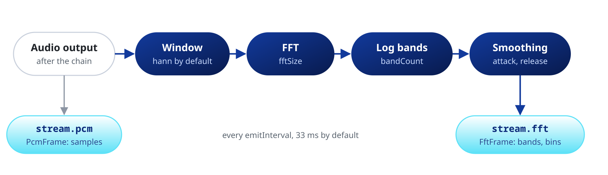
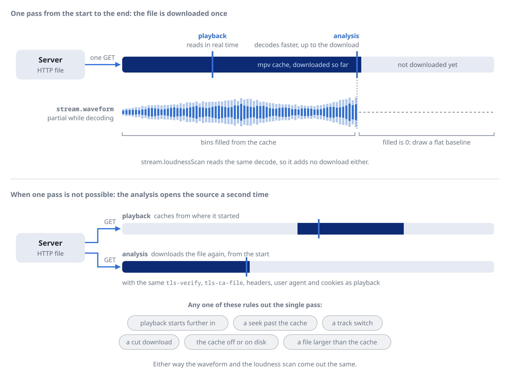

Draw a spectrum, a waveform or a level meter, and measure loudness.

`stream.fft` and `stream.pcm` carry the audio going to the output, after the effects chain and the volume.



Each stream on this page starts on the first `listen()` and stops on the last cancel. The live meter, `loudnessMeter`, also needs an `Ebur128Effect(metadata: true)` in the chain.

The analysis is shared by the whole process. With several players, `fft` and `pcm` show the audio of the last output, and two players tapping the same stage read one mixed feed.

## Spectrum

```dart
player.stream.fft.listen((frame) {
  for (var i = 0; i < frame.bands.length; i++) {
    final h = frame.bands[i] * canvasHeight; // from 0 to 1
    // Draw bar i with height h
  }
});
```

Paint `bands` as they come. They rise fast and fall slowly, so the bars move smoothly without animation code. `bins` holds the unsmoothed bins on a linear frequency axis, from 0 to 1, for your own mapping. `timestamp` is the engine clock, not the track position.

No frames arrive while playback is paused, and the last one stays. Fade the bars on pause yourself.

### Settings

```dart
// 60 frames a second, 128 bands, a dB window 10 dB higher
player.setSpectrum(const SpectrumSettings(
  bandCount: 128,                           // 64 by default
  emitInterval: Duration(milliseconds: 16), // 33 ms by default, at least 8 ms
  minDb: -90,
  maxDb: -20,
));

// One field, from a slider
player.updateSpectrum((s) => s.copyWith(attackSmoothing: 0.7));
```

`attackSmoothing` sets how fast a band rises, and `releaseSmoothing` how fast it falls. The smoothing steps once per FFT, so a shorter `emitInterval` or a larger `overlapFactor` also makes the bands move faster. `fftSize` is 2048, `window` Hann and the bands span 20 Hz to 20 kHz by default.

## Samples

`stream.pcm` emits the samples at the same rate as `fft`, for an oscilloscope, a level meter or your own analysis.

```dart
double peak = 0;
player.stream.pcm.listen((frame) {
  for (final s in frame.samples) { // interleaved as L, R, L, R
    if (s.abs() > peak) peak = s.abs();
  }
  peak *= 0.92; // decay
});
```

Consecutive frames overlap. A scrolling display draws only the samples it has not drawn yet.

### Taps on the chain

A tap captures the samples before or after one stage of the effects chain.

```dart
player.stream
    .tap(AudioFilter.equalizer, side: TapSide.pre)
    .listen((pcm) => paintInput(pcm.samples));

// Bands from a tap, with the same FFT and smoothing as stream.fft
final processor = BandProcessor(player.state.settings.spectrum);
player.stream.spectrum.listen(processor.setSettings);
player.stream.tap(AudioFilter.equalizer, side: TapSide.post).listen((pcm) {
  final fft = processor.process(pcm);
  if (fft != null) paintBands(fft.bands);
});
```

`instance` picks the stage when a filter appears more than once. Disabled stages count, and they emit nothing. Up to eight stages can be tapped at once across all players.

## Waveform

`stream.waveform` emits a mono envelope of the loaded file in about 2000 bins, or a rolling window of up to 131072 bins for a live stream. Use it for an overview or a waveform seek bar.

```dart
player.stream.waveform.listen((wave) {
  if (wave == null) return; // null at each file load
  for (var i = 0; i < wave.bins; i++) {
    if (wave.filled[i] == 0) continue; // no data yet, draw a baseline
    // Outline from wave.min[i] to wave.max[i], range -1 to 1
    final rms = wave.rms; // null when libmpv does not report it
    if (rms != null) {
      // Body from -rms[i] to rms[i], range 0 to 1
    }
  }
});
```

On loud, heavily limited masters, draw `rms` as the body and min and max as a lighter outline.

| Source | Envelope |
| :--- | :--- |
| Local file | Decoded ahead, with partial envelopes while `decoding` is true |
| HTTP file played from its start | Decoded from the libmpv cache as it downloads |
| Transcode with no length | As above, when `Media.waveformDurationHint` gives the length |
| Adaptive, non-seekable or other transcoded streams | Fills in as playback advances |
| Live stream | A rolling window, with `live` true |
| External track from `addAudioTrack` | Fills in as playback advances |

A network file downloads once, because the analysis reads the libmpv cache. After a seek past the cache, or with a file larger than the cache, the analysis opens the source a second time with the playback network options.



## Loudness scan

`stream.loudnessScan` measures the EBU R128 loudness of the loaded file, many times faster than real time. It emits snapshots with `progress`, then one result with integrated loudness, range, sample peak and true peak.

```dart
// Level every file to -18 LUFS, with ReplayGain off
player.stream.loudnessScan.listen((scan) {
  if (scan?.state == LoudnessScanState.ready) {
    player.setVolumeGain((-18.0 - scan!.integrated!).clamp(-24.0, 24.0));
  }
});
```

The stream emits `null` at each file load. Adaptive, live and non-seekable streams and external tracks report `LoudnessScanState.unavailable`, so use the live meter for them.

## Live meter

`stream.loudnessMeter` reads the first enabled `Ebur128Effect` with `metadata: true`. Without one it emits nothing.

```dart
await player.updateAudioEffects((fx) => [...fx, const Ebur128Effect(metadata: true)]);
player.stream.loudnessMeter.listen((l) => paintMeter(l.momentary ?? -120.7));
```

`momentary` and `shortTerm` sit near -120.7 LUFS during silence and until their window fills, so clamp them to your scale. `integrated` starts at -70 LUFS. The meter restarts at every seek, loop and entry change, so use the scan for a whole file.

See the [Effects](https://pub.dev/documentation/mpv_audio_kit/latest/topics/Effects-topic.html) topic.
