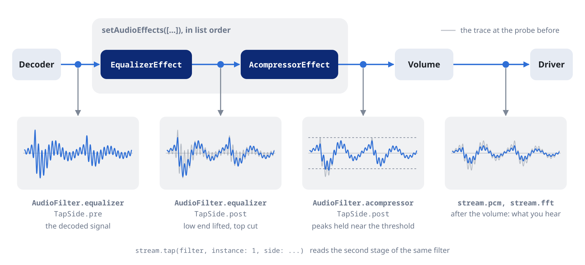

Shape the sound with a chain of FFmpeg filters. The chain works the same on every platform, the web included.



## The chain

The chain is a list of stages, one class per filter. Stages run in list order, and a filter can appear more than once.

```dart
await player.setAudioEffects([
  EqualizerEffect(frequency: 100, width: 50, widthType: EqualizerWidthType.h, gain: 3),
  AcompressorEffect(threshold: 0.1, ratio: 4),
  AlimiterEffect(limit: 0.9), // limit last
]);
```

`setAudioEffects` replaces the whole chain, for a preset or saved settings. `updateAudioEffects` changes the current one, for a slider or a toggle:

```dart
await player.updateAudioEffects((fx) => [
  for (final e in fx)
    e is AcompressorEffect ? e.copyWith(enabled: false) : e,
]);
```

A stage with `enabled: false` stays in the list with its settings, and the sound bypasses it.

Moving a slider updates the running filter without a glitch for most gains, frequencies and levels. The class docs mark which parameters do. Adding, removing or reordering stages rebuilds the ones they touch. The chain stays from one track to the next.

```dart
player.stream.audioEffects.listen((fx) => print('${fx.length} stages'));

await player.setAudioEffects(const []); // clear
```

## The effects

Each FFmpeg filter has a class named after it: `acompressor` is `AcompressorEffect`. Its parameters are the filter's options in camelCase, so `level_in` is `levelIn`.

```dart
await player.setAudioEffects(const [
  LoudnormEffect(i: -16, tp: -1.5, lra: 11),     // EBU R128 loudness
  SuperequalizerEffect(params: {'4b': 1.5, '8b': 0.5}),
  BassEffect(gain: 4, frequency: 100),
  AtempoEffect(tempo: 1.1),                      // tempo without pitch change
  CrossfeedEffect(),                             // for headphones
]);
```

Every numeric parameter has bounds and a default for a slider, such as `AcompressorEffect.thresholdMin`, `thresholdMax` and `thresholdDefault`. Parameters with fixed choices are enums.

| Group | Effects |
| :--- | :--- |
| Dynamics and loudness | `acompressor`, `agate`, `alimiter`, `compand`, `deesser`, `dynaudnorm`, `loudnorm`, `mcompand` and 9 more |
| Equalization and tone | `bass`, `treble`, `equalizer`, `superequalizer`, `firequalizer`, `lowshelf`, `highshelf` and 5 more |
| Filters | `highpass`, `lowpass`, `bandpass`, `bandreject`, `allpass` and 4 more |
| Pitch and tempo | `atempo`, `asetrate`, `aresample`, `afreqshift`, `aphaseshift` |
| Stereo and space | `crossfeed`, `extrastereo`, `stereowiden`, `haas`, `surround`, `virtualbass` and 3 more |
| Creative | `aecho`, `chorus`, `flanger`, `aphaser`, `tremolo`, `vibrato` and 7 more |
| Restoration | `adeclick`, `adeclip`, `afftdn`, `anlmdn`, `arnndn` and 6 more |
| Utility | `afade`, `silenceremove`, `apad`, `aformat`, `pan`, `channelmap`, `aeval` and 2 more |

There are 86 in all. The API reference lists every class with its options.

## Any other filter

A `RawAudioEffect` adds a filter the typed classes do not cover:

```dart
await player.setAudioEffects(const [
  RawAudioEffect('lavfi-aeval=val(0)*0.5|val(1)*0.5'),
  AcompressorEffect(threshold: 0.1),
]);
```

Any change to a chain with a raw stage rebuilds it instead of updating the filter live.

## ReplayGain

```dart
await player.setReplayGain(const ReplayGainSettings(
  mode: ReplayGain.track, // or .album, .no
  preamp: 2.0,            // dB on top of the tag
  fallback: -6.0,         // dB for files without tags
));
```

## Gapless playback

Tracks follow each other without a gap when their formats allow it. On a network playlist, prefetch opens the next track before the current one ends:

```dart
await player.setPrefetchPlaylist(true);
```
