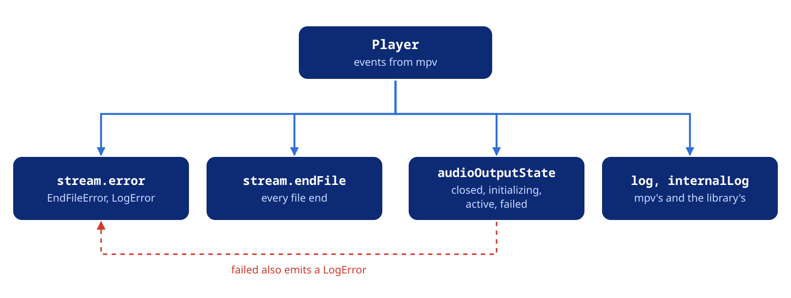

Catch failed loads, cut streams, a silent output and failed calls, and read the logs.



## The error stream

`stream.error` emits a `PlayerError` with two subtypes:

- `EndFileError`: a file stopped because of an error.
- `LogError`: libmpv logged an error or a fatal message. Playback can go on.

```dart
player.stream.error.listen((error) {
  switch (error) {
    case EndFileError():
      print('File failed: ${error.reason}, code ${error.code}');
      if (error.isLoadingError) print('network or file not found');
    case LogError():
      print('libmpv error: ${error.message}');
  }
});
```

An `EndFileError` tells the cause with `isLoadingError`, `isAudioOutputError` and `isFormatError`. A `LogError` carries the subsystem in `prefix`, such as `ffmpeg`, `ao` or `demux`.

## End of a file

`stream.endFile` emits an `MpvFileEndedEvent` every time a file ends, with its `reason`. Read the entry from the event, because `player.state` can already describe the next entry.

The event carries the `Media` of the entry, its last `position` and its `duration`. `media` is `null` for an entry from a playlist file.

### Cut streams

A dropped connection ends the file with a normal `eof`. Check `readError` and `skippedSegments` to tell a cut from the real end:

```dart
player.stream.endFile.listen((event) {
  if (event.readError == true || (event.skippedSegments ?? 0) > 0) {
    print('${event.media?.uri} was cut short at ${event.position}');
  }
});
```

`skippedSegments` counts the HLS and DASH segments lost to errors. Both fields are `null` when libmpv cannot report them.

The last entry of the playlist stays open at its end. `state.completed` turns true, and `state.readError` tells how it ended:

```dart
player.stream.completed.listen((completed) {
  if (completed && player.state.readError == true) {
    print('The last track was cut short at ${player.state.position}');
  }
});
```

Its `endFile` event comes later, with `reason: stop`, when the entry is stopped or replaced.

- The player retries a dropped connection first. It counts as a read error only after every retry failed. See the [Network and cache](https://pub.dev/documentation/mpv_audio_kit/latest/topics/Network%20and%20cache-topic.html) topic.
- A seek after a cut reads again, and the entry plays on if the server answers.
- `duration` can be an estimate, so comparing it with `position` does not detect a cut.

## A silent output

`stream.audioOutputState` follows the audio output.

```dart
player.stream.audioOutputState.listen((state) {
  switch (state) {
    case AudioOutputState.closed:       // no output open
    case AudioOutputState.initializing: // opening
    case AudioOutputState.active:       // open
    case AudioOutputState.failed:       // no output could open
  }
});
```

When no device opens, libmpv falls back to its null output. The state is `active`, the position runs and nothing is heard. `stream.error` then emits a `LogError`, unless you chose the null driver with `setAudioDriver('null')`.

`failed` comes only when the null output cannot open either. Each file then ends with an `EndFileError` whose `isAudioOutputError` is true.

## Logs

`stream.log` carries the messages of libmpv and FFmpeg. `stream.internalLog` carries the package's own messages, such as hook timeouts and resolver errors. Route them to different places:

```dart
player.stream.log.listen((entry) {
  if (entry.level == LogLevel.error || entry.level == LogLevel.fatal) {
    print('[${entry.level.mpvValue}] ${entry.prefix}: ${entry.text}');
  }
});

player.stream.internalLog.listen((entry) {
  print('[package:${entry.level.mpvValue}] ${entry.text}');
});
```

`PlayerConfiguration.logLevel` sets the starting level, `LogLevel.warn` by default.

```dart
player.setLogLevel(LogLevel.debug); // while developing
player.setLogLevel(LogLevel.off);   // silence libmpv
```

## Exceptions

A call that fails throws a `PlayerException`:

| Exception | When |
| :--- | :--- |
| `PlayerDisposedException` | The player was disposed |
| `PlayerInitException` | libmpv could not load or start. Every call on that player throws it |
| `MpvCommandException` | libmpv rejected the request, such as a seek with no file loaded |
| `SourceException` | A source could not open, such as a missing asset or an unreadable `content://` URI |

```dart
try {
  await player.seek(position);
} on PlayerException catch (e) {
  switch (e) {
    case PlayerDisposedException():
      break;
    case PlayerInitException(:final message):
      print('libmpv did not start: $message');
    case MpvCommandException(:final name, :final message):
      print('$name rejected: $message');
    case SourceException(:final uri):
      print('Cannot open $uri');
  }
}
```

An invalid argument, such as a negative volume, throws `ArgumentError` or `RangeError` before the call reaches libmpv. `next()` and `previous()` return `false` when there is no entry to go to.
