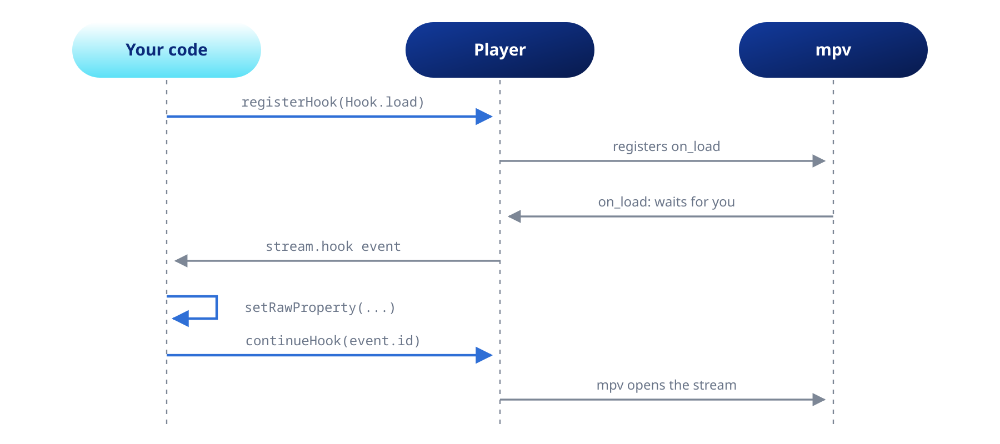
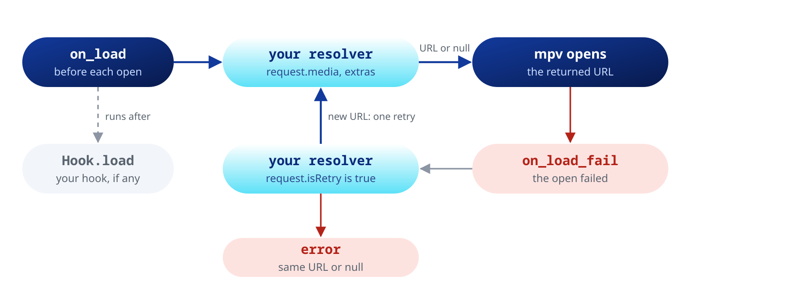

Step into the loading of each entry with a source resolver or a hook, and reach any mpv property or command directly.

A hook pauses mpv at one step of loading a file until your code lets it go on. Use it to resolve a URL at the last moment, add headers for one file or switch to another source.



For headers alone, pass them in `Media.httpHeaders` (see the [Playback](https://pub.dev/documentation/mpv_audio_kit/latest/topics/Playback-topic.html) topic).

## The source resolver

`setSourceResolver` resolves the URL of each entry right before it opens. It needs no `registerHook` and no `continueHook`.

```dart
await player.setSourceResolver((request) async {
  final id = request.media.extras?['trackId'] as String?;
  if (id == null) return null;       // not ours: keep the URL
  return service.getPlaybackUrl(id); // a temporary or signed URL
});

// Queue by id. No network calls happen until each entry opens.
await player.openAll([
  Media('resolve://1', extras: {'trackId': '1'}),
  Media('resolve://2', extras: {'trackId': '2'}),
]);
```

The resolver gets the entry's original `Media`, with its `extras` and `httpHeaders`. It runs before every stream opens and before the next entry opens ahead of time.

After a failed open it runs once more with `request.isRetry` set. Return a fresh URL, such as one with a new token, and mpv tries again. This happens at most once per load, and only when the new URL differs.



| The resolver | The result |
| :--- | :--- |
| Returns `null` or `request.uri` | The URL stays as it is |
| Throws | The error goes to `internalLog` and the URL stays |
| Returns a `file://` URL | The entry plays that local path |
| Runs past `timeout` | The load goes on and a later URL is dropped |

```dart
await player.setSourceResolver(resolve, timeout: const Duration(seconds: 5)); // 15 s by default
await player.setSourceResolver(null); // remove it
```

With prefetch on, the entry reuses the URL resolved for the prefetch, so a signed URL keeps the gapless change. A resolver slower than the rest of the playing track misses the prefetch and runs again when the entry opens.

Entries open one at a time, so the calls never overlap. This suits a music server that allows one transcoding session.

## Hooks

Register a hook after you create the player, and await it before the first `open`:

```dart
await player.registerHook(Hook.load);

// The package continues the hook itself if your code has not after 10 s
await player.registerHook(Hook.load, timeout: const Duration(seconds: 10));
```

`Hook.load` fires before the stream opens, and `Hook.loadFail` fires after it failed to open. `Hook.prefetch` fires before the next entry opens ahead of time. The API reference lists the other hooks.

### Listening and continuing

Call `continueHook` on every path, errors included. mpv waits until you do.

```dart
player.stream.hook.listen((event) async {
  try {
    if (event.hook == Hook.load) {
      final url = await player.getRawProperty('stream-open-filename') ?? '';
      if (url.startsWith('my-scheme://')) {
        await player.setRawProperty('stream-open-filename', await myResolver(url));
      }
    }
  } finally {
    player.continueHook(event.id);
  }
});
```

A source resolver runs first, and then your listener gets the same event.

### Headers for one file

```dart
await player.setRawProperty(
  'file-local-options/http-header-fields',
  'Authorization: Bearer abc123', // separate several headers with commas
);
```

The headers reach an HLS playlist and every segment. During `Hook.prefetch` the current file is the one still playing, so put per-entry headers in `Media.httpHeaders`.

### Prefetch

With `setPrefetchPlaylist(true)`, `Hook.prefetch` runs for the next entry:

- `prefetch-open-filename` holds the URL mpv will open. Write it to open another one.
- `prefetch-playlist-entry-id` names the entry.
- When the entry starts, `Hook.load` sees the original URL. Write the same URL as in the prefetch, or mpv drops the early stream and opens the entry again.
- Properties such as `path` and `file-local-options/...` still belong to the playing entry.

mpv drops the early open when the current entry ends or the next one changes before you continue the hook.

## Raw access

Any property and command of the [mpv manual](https://mpv.io/manual/master/) is reachable directly. Prefer a typed setter when one exists: it updates `state` at once, and a raw write shows up only when mpv reports it.

```dart
final String? codec = await player.getRawProperty('audio-codec'); // null when it fails
final tracks = await player.getRawPropertyNode('track-list') as List?; // decoded

try {
  await player.setRawProperty('audio-channels', 'stereo');
  await player.sendRawCommand(['ao-reload']);
} on MpvCommandException catch (e) {
  print('mpv rejected ${e.name}: ${e.message} (code ${e.code})');
}
```

`af` and `pause` belong to the player. Writes to them throw `ArgumentError`, through any property path or command, `af-command` and `loadfile` options included. Use the effects chain (see the [Effects](https://pub.dev/documentation/mpv_audio_kit/latest/topics/Effects-topic.html) topic) and `play()` or `pause()` instead.
