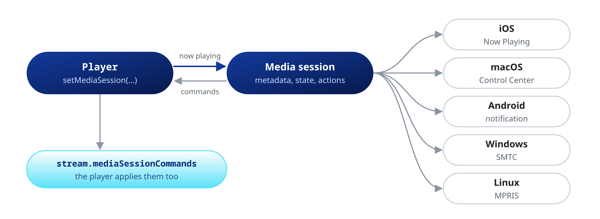

Show the player in the system media controls and apply the commands they send back.

| Platform | Controls |
| :--- | :--- |
| iOS, macOS | Now Playing, Control Center, lock screen |
| Android | Media notification |
| Windows | SMTC |
| Linux | MPRIS |
| Web | `navigator.mediaSession` |

See the [Web](https://pub.dev/documentation/mpv_audio_kit/latest/topics/Web-topic.html) topic for the web session.



## Session

```dart
await player.setMediaSession(const MediaSession()); // title, artist, album and cover from the file
await player.setMediaSession(null);                 // remove
```

One `Player` per process owns the session, and it must live in the root isolate. A second player throws `StateError`, even from another Flutter engine in the same process. The owner keeps the session until it passes `null` or is disposed.

## Metadata

```dart
await player.setMediaSession(
  (player.state.settings.mediaSession ?? const MediaSession())
      .copyWith(title: 'Custom title', artist: 'Custom artist'),
);
```

`null` keeps the file's value, and an empty string leaves the field blank. For a file without tags, each field falls back to `title`, `artist`, `album` and `art` in `Media.extras`. With no title anywhere, the session shows the title libmpv takes from the URL.

## Artwork

```dart
const MediaSession(artwork: MediaSessionArtwork.embedded);     // the file's cover, by default
MediaSession(artwork: MediaSessionArtwork.uri(Uri.parse(url))); // an image the package loads
MediaSession(artwork: MediaSessionArtwork.custom(cover));       // your own CoverArt
const MediaSession(artwork: MediaSessionArtwork.none);
```

On native platforms the package downloads a network cover and hands the OS the bytes, so a URL with credentials never reaches the OS. The download always verifies the certificate and refuses a redirect from `https` to `http`. It skips images over 20 MiB.

| Scheme | Where |
| :--- | :--- |
| `http://`, `https://` | Every platform |
| `file://` | Every platform except the web |
| `asset:///assets/cover.png` | Every platform, with three slashes |
| `content://`, `android.resource://` | Android, for an image file |
| `blob:` | The web |

For any other scheme, or a cover that needs headers, load the bytes yourself and use `MediaSessionArtwork.custom`. A `Uri` lowercases the host, so pass an Android authority with capitals as a string in `extras['art']`.

## Commands

The player applies OS commands itself and also emits them:

```dart
player.stream.mediaSessionCommands.listen((command) {
  switch (command) {
    case MediaSessionCommandSeekTo(:final position):
      print('Scrubbed to $position');
    case MediaSessionCommandNext():
      myQueue.next(); // with one entry, next is only emitted
    case _:
      break;
  }
});
```

### Actions

`actions` lists the controls the OS may show. The default is play, pause, play-pause, next, previous and seek. `stop`, `fastForward`, `rewind`, `setRepeatMode`, `setShuffle`, `setPlaybackRate` and `like` are also available.

```dart
const MediaSession(
  actions: {
    MediaAction.playPause, MediaAction.seek,
    MediaAction.fastForward, MediaAction.rewind, MediaAction.next, MediaAction.previous,
  },
  fastForwardInterval: Duration(seconds: 30), // 15 s by default
  autoApplyPlaylistNavigation: false,         // next and previous only emit commands
);
```

The intervals and `supportedPlaybackRates` apply only with their action in the set. In an audiobook app, for example, map next and previous to a 30 s skip.

A platform leaves out the actions it does not draw. The table shows what the package registers.

| Action | iOS | macOS | Android | Windows | Linux |
| :--- | :--: | :--: | :--: | :--: | :--: |
| play, pause, next, previous | Yes | Yes | Yes | Yes | Yes |
| `seek` | Yes | Yes | Yes | Yes | Yes |
| `fastForward`, `rewind` | Yes | Yes | Yes | Yes | No |
| `stop` | Yes | Yes | Yes | Yes | Yes |
| `setRepeatMode`, `setShuffle` | Yes | Yes | Yes | Yes | Yes |
| `setPlaybackRate` | Yes | Yes | Yes | Yes | Yes |
| `like` | Yes | Yes | Yes | No | No |

GNOME shows only previous, play-pause and next.

## Interruptions

`interruptionPolicy` decides what a phone call or another app's audio does on iOS, Android and the web:

```dart
const MediaSession(interruptionPolicy: InterruptionPolicy.pauseAndResume); // default
const MediaSession(interruptionPolicy: InterruptionPolicy.pauseOnly);      // never resumes on its own
const MediaSession(interruptionPolicy: InterruptionPolicy.keepPlaying);
```

- With `keepPlaying`, an accepted call or a voice assistant still takes the audio on iOS. Android 12 and later may fade the app out.
- On the web the interruption is a pause of the session's `<audio>` element from outside the page (the browser, a call, another app). It ends when the browser plays the element again, or when the page's audio runs again after an interruption (iOS). Not every browser does either.
- Unplugging headphones always pauses.
- On iOS the audio does not mix with other apps. Loading a file stops another app's audio, even with `play: false`.

Background playback needs the iOS and Android setup in [Permissions](https://pub.dev/packages/mpv_audio_kit#permissions).

## App name on the desktop

```dart
const MediaSession(
  appName: 'My Player',              // MPRIS and SMTC
  desktopEntry: 'com.example.myapp', // Linux: the .desktop file name, for the icon
);
```

macOS, iOS and Android take the name from the app bundle. Windows takes the icon from the executable.
