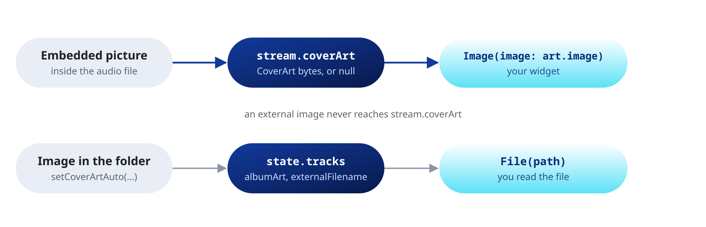

Read the tags and the cover art of the playing file.

## Tags

Keys keep the case the file stores them in, so look them up without case:

```dart
String? tag(Map<String, String> tags, String key) => tags.entries
    .where((e) => e.key.toLowerCase() == key.toLowerCase())
    .map((e) => e.value)
    .firstOrNull;

player.stream.metadata.listen((tags) {
  print('Now playing: ${tag(tags, 'title')}, ${tag(tags, 'artist')}');
});

final album = tag(player.state.file.metadata, 'album');
```

Common keys are `title`, `artist`, `album`, `album_artist`, `date`, `track`, `disc`, `genre`, `comment` and `composer`.

## Cover art



`coverArt` carries the picture embedded in the file.

```dart
StreamBuilder<CoverArt?>(
  stream: player.stream.coverArt,
  builder: (context, snapshot) {
    final art = snapshot.data;
    if (art == null) return const Icon(Icons.music_note, size: 96);
    return Image(image: art.image, fit: BoxFit.cover);
  },
);

// Save it to disk
final art = player.state.file.coverArt;
if (art != null) {
  await File('${dir.path}/cover.${art.extension}').writeAsBytes(art.bytes);
}
```

`bytes` holds the image as stored, without re-encoding. `mimeType` and `extension` give its type, and `extension` is empty for an unknown type.

The stream emits on every file load, a reload of the same file included. It emits `null` for a file without a picture, so the UI clears the previous cover. It also emits `null` when `open`, `openAll` or `openPlaylistFile` return, so a new cover always follows a `null`.

### Images in the folder

`setCoverArtAuto` loads an image next to the audio file as an extra track. It is off by default, so unrelated images stay out.

```dart
await player.setCoverArtAuto(Cover.exact); // same base name, or cover.jpg, folder.jpg and the like
await player.setCoverArtAuto(Cover.fuzzy); // also images whose name contains the base name
await player.setCoverArtAuto(Cover.all);   // every image in the folder
await player.setCoverArtAuto(Cover.no);    // off
```

That image never reaches `stream.coverArt`. Find it among the tracks and read the file yourself:

```dart
final path = player.state.file.tracks
    .where((t) => t.external && t.albumArt)
    .firstOrNull
    ?.externalFilename;
```
