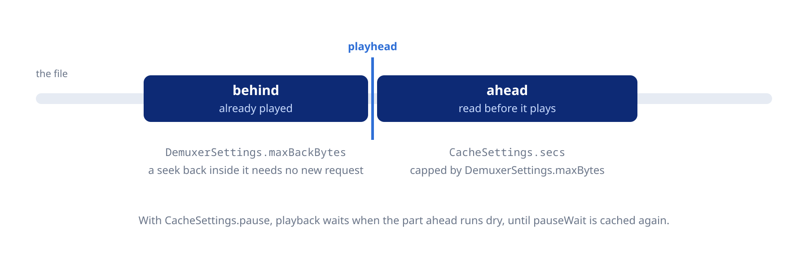

Tune the cache, the network settings and the reconnection of streamed sources.

## Cache

```dart
await player.setCache(const CacheSettings(
  mode: Cache.yes,                 // or .auto (default), .no
  secs: Duration(seconds: 30),     // how far ahead of the playhead to cache
  onDisk: true,                    // a file instead of memory
  pause: true,                     // pause when the cache runs dry (default)
  pauseWait: Duration(seconds: 3), // cached time needed to resume, default 1 s
  pauseInitial: true,              // also wait before the start and after a seek
));

// Change one field
await player.setCache(player.state.cache.copyWith(secs: const Duration(seconds: 60)));
```

`pauseInitial` gives network sources a smoother start, and it needs `pause` on.

With `onDisk`, create the player with `PlayerConfiguration(demuxerCacheDir: ...)` and a writable folder. The default location is often not writable on mobile.

### Demuxer buffer

The demuxer reads the container and buffers its packets. `setDemuxer` sets how much it keeps.

```dart
await player.setDemuxer(const DemuxerSettings(
  maxBytes: 50 * 1024 * 1024,      // ahead of the playhead, default 150 MiB, 64 MiB on the web
  maxBackBytes: 20 * 1024 * 1024,  // behind the playhead, default 50 MiB, 16 MiB on the web
  readahead: Duration(seconds: 5), // default 1 s
));
```



`maxBytes` bounds the cache in practice, because the default `CacheSettings.secs` is 1000 hours.

## Live streams

For live radio, turn off the cache, the cache pause and the back buffer:

```dart
await player.open(Media('https://stream.radio.example.com/live.mp3'));
await player.setCache(const CacheSettings(mode: Cache.no, pause: false));
await player.setDemuxer(player.state.demuxer.copyWith(maxBackBytes: 0));
```

Set seeking and the HLS variant in the configuration:

```dart
final player = Player(
  configuration: const PlayerConfiguration(
    forceSeekable: true,        // seek within the cache on a stream marked unseekable
    hlsBitrate: HlsBitrate.min, // the lowest variant, to save data (default .max)
  ),
);

await player.setHlsBitrate(HlsBitrate.max); // from the next load
```

### Throttling servers

Some servers slow a single open-ended request to a crawl. Playback starts, then stalls after a seek once the buffer runs out. `httpChunkSize` splits the download into bounded range requests:

```dart
await player.open(Media(url, httpChunkSize: 8 * 1024 * 1024)); // 8 MiB, positive
```

It applies to that entry only. Leave it `null` for servers that do not throttle, such as a music server of your own, because one request buffers fastest there.

## Connection settings

```dart
await player.setNetworkTimeout(const Duration(seconds: 10)); // default 60 s

await player.setTlsVerify(true);                     // off by default
await player.setTlsCaFile('/path/to/company-ca.pem'); // '' for the built-in roots

await player.setHttpProxy('http://proxy.example:8080'); // '' clears it
await player.setCookies(true);                          // off by default
```

- `Duration.zero` uses FFmpeg's default timeout for each protocol. For `smb2://` it gives the connection 30 s and no limit on the reads.
- The longest timeout is about 36 minutes, and a longer one is capped there.
- TLS verification uses the CA roots built into libmpv. A CA file replaces them.
- The proxy and cookies take effect from the next load. `https://` sources go through the proxy with `CONNECT`.

## Monitoring

```dart
// The buffered parts of a seek bar
player.stream.demuxerCacheState.listen((cache) {
  for (final r in cache.seekableRanges) print('buffered ${r.start} to ${r.end}');
});

// A network stall
player.stream.pausedForCache.listen((waiting) {
  if (waiting) showBufferingIndicator();
});
```

`demuxerCacheState` also gives the download rate and the `eofCached`, `bofCached` and `underrun` flags. It is empty for local files. `stream.demuxerViaNetwork` tells whether the current file comes over the network.

## Dropped connections

The player retries an HTTP connection that drops or fails to open:

- A cut download resumes where it stopped, after 0, 1, 3 and 7 s, on a server that accepts range requests. Files and HLS segments both resume.
- A connection that fails to open is retried on the same schedule. An unreachable server fails the entry after about 11 s.
- An HLS segment that fails to open gets four more tries before the player skips it.

Protocols other than HTTP, such as `smb2://`, do not retry.

The retries come from the global `stream-lavf-o` option. Setting it with `setRawProperty` replaces them, so add a key with `change-list` instead. This one allows longer waits between retries, up to 30 s:

```dart
await player.sendRawCommand(['change-list', 'stream-lavf-o', 'add', 'reconnect_delay_max=30']);

// Fail at once on an unreachable server, for one entry
Media(url, streamLavfOptions: {'reconnect_on_network_error': '0'});
```

`Media.streamLavfOptions` wins over the global value. A live stream that drops stays closed by default. Reopen it with `reconnect_streamed`:

```dart
await player.open(Media(
  'https://stream.radio.example.com/live.mp3',
  streamLavfOptions: {'reconnect_streamed': '1'},
));
```

Use it for live streams only. A file from a server without range support would start over after a cut.

With `setPrefetchPlaylist(true)`, the player opens an entry with stream options ahead only when the playing entry has the same ones.

On the web the browser handles TLS, cookies and proxies. See the [Web](https://pub.dev/documentation/mpv_audio_kit/latest/topics/Web-topic.html) topic.
