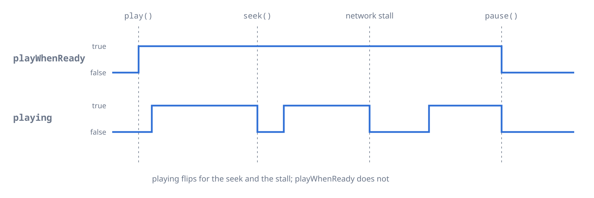

Open sources, build a queue and control playback.

## Sources

A `Media` describes one entry. It holds a URI, optional data and options.

```dart
final remote  = Media('https://cdn.example.com/audio.flac');
final local   = Media('file:///home/user/music/song.flac');
final asset   = Media('asset:///assets/audio/sample.mp3');
final content = Media('content://media/external/audio/media/42'); // Android
final share   = Media('smb2://nas.local/music/song.flac');
```

| Scheme | Source |
| :--- | :--- |
| `file://` | A local file, by absolute path |
| `asset:///` | A Flutter asset bundled with the app |
| `content://` | An Android content URI, from a file picker or the media store |
| `https://`, `http://` | A file or a live stream over HTTP |
| `https://…/*.m3u8` | An HLS stream |
| `https://…/*.mpd` | A DASH stream |
| `smb2://` | A file on an SMB2 or SMB3 share |
| `blob:` | A file the user picked in the browser. See the [Web](https://pub.dev/documentation/mpv_audio_kit/latest/topics/Web-topic.html) topic. |

### Windows paths

On Windows, `file://server/share/...` opens the network share. A path of 260 characters or more needs `LongPathsEnabled` in the registry. It also needs `longPathAware` in `windows/runner/runner.exe.manifest`:

```xml
<longPathAware xmlns="http://schemas.microsoft.com/SMI/2016/WindowsSettings">true</longPathAware>
```

Without them libmpv refuses the file.

### Background isolates

In a background isolate, call `ensureInitialized` there too with `hotRestartCleanup: false`. Asset sources do not load there, so copy the asset to a file. Content URIs need `BackgroundIsolateBinaryMessenger.ensureInitialized`.

### Headers

```dart
await player.open(Media(
  'https://api.example.com/stream/episode-42.mp3',
  httpHeaders: {'Authorization': 'Bearer my_token'},
));
```

The headers go with every request of that entry, HLS segments included, and never with other entries. To resolve or refresh a URL when its entry opens, use a source resolver (`Player.setSourceResolver`).

### Your own data

```dart
final media = Media(
  'https://cdn.example.com/track.mp3',
  extras: {'title': 'Track Title', 'artist': 'Artist Name', 'isPodcast': true},
);

final extras = player.state.playlist.items[index].extras;
```

Playback ignores `extras`. The OS media session reads `title`, `artist`, `album` and `art` from it when the file has no tags.

### Live PCM

A `PcmSource` plays raw PCM as it arrives, such as speech from a socket.

```dart
final source = await player.openPcmStream(
  const PcmFormat(sampleRate: 24000, channels: 1), // s16le by default
);
await source.addStream(socket
    .where((m) => m is List<int>)
    .map((m) => m is Uint8List ? m : Uint8List.fromList(m as List<int>)));
await source.close(); // plays out what is buffered, then ends the entry
```

Playback starts about 0.2 s after the first chunk, or 0.1 s with `lowLatency: true`. A source plays once and cannot seek.

## The queue

```dart
// One entry
await player.open(media);              // follows PlayerConfiguration.autoPlay
await player.open(media, play: true);

// Several entries, starting at the second
await player.openAll([track1, track2, track3], index: 1);

// A playlist file: .m3u, .m3u8, .pls or .cue
await player.openPlaylistFile(Media('https://example.com/stations.m3u'));
```

A playlist file loads its `smb2://` entries only when the list itself is on `smb2://`. Setting `load-unsafe-playlists` to `yes` with `setRawProperty` lifts this for every protocol, so use it only for lists you trust.

Change the queue while it plays:

```dart
await player.add(track);                                     // append
await player.insert(player.state.playlist.index + 1, track); // play next
await player.move(5, 0);
await player.replace(2, track);
await player.remove(0);
await player.clearPlaylist(keepCurrent: true);
```

Move through it:

```dart
await player.next();     // false when there is no next entry
await player.previous();
await player.jump(2);    // 0-based, starts playing

await player.setLoop(Loop.playlist); // or Loop.file, Loop.off
await player.setShuffle(true);
```

### Gapless and prefetch

Tracks follow each other without a gap when their formats allow it. `setGapless(Gapless.weak)` is the default. On a network playlist, prefetch opens the next entry before the current one ends:

```dart
await player.setGapless(Gapless.weak); // or Gapless.yes, Gapless.no
await player.setPrefetchPlaylist(true);
```

`stream.prefetchState` follows the prefetch. See the [State and streams](https://pub.dev/documentation/mpv_audio_kit/latest/topics/State%20and%20streams-topic.html) topic for its values.

### Part of a file

```dart
// Start 12 minutes in
await player.open(Media(path, start: const Duration(minutes: 12)));

// A 30 second preview from 1:00
await player.open(Media(
  url,
  start: const Duration(minutes: 1),
  end: const Duration(minutes: 1, seconds: 30),
));
```

### Chapters

```dart
player.stream.chapters.listen((chapters) {
  for (final (i, c) in chapters.indexed) print('$i. ${c.title} @ ${c.time}');
});

await player.setChapter(2); // -1 goes to the start of the file
```

A file without chapters can get yours with `setChapters`.

## Controls

```dart
await player.play();
await player.pause();
await player.stop();

// A play and pause button
player.state.playWhenReady ? await player.pause() : await player.play();
```

`playWhenReady` holds what the user asked for. See the [State and streams](https://pub.dev/documentation/mpv_audio_kit/latest/topics/State%20and%20streams-topic.html) topic for the other flags.



### Seeking

```dart
await player.seek(const Duration(seconds: 30));
await player.seek(const Duration(seconds: 10), relative: true);
await player.seek(const Duration(seconds: 30), exact: true); // slower, sample-accurate
await player.seekToPercent(50);                              // for a progress bar
```

### A-B loop

```dart
await player.setAbLoopA(const Duration(seconds: 30));
await player.setAbLoopB(const Duration(seconds: 45));
await player.setAbLoopCount(3); // the section plays 4 times, null repeats forever
```

The points apply to the current entry and reset when another one loads. A point set with no file loaded applies to every file.

### Speed, pitch and volume

```dart
await player.setRate(1.5);       // keeps the pitch while pitch correction is on
await player.setPitch(0.9);      // lower pitch, same speed

await player.setVolume(80);      // 100 is unity, the scale is cubic
await player.setMute(true);
await player.setSystemVolume(70); // the driver's volume, where it has one
```

### Resume points

To resume audiobooks and podcasts, call `writeResumeConfig`, and the next open of the file starts there. On mobile, set `watchLaterDir` to a writable folder.

```dart
final player = Player(
  configuration: const PlayerConfiguration(watchLaterDir: '/path/to/watch_later'),
);

await player.writeResumeConfig(); // save now, for example on pause
```

The player saves nothing on its own. To keep the position in your app instead, open the file with `Media.start`.

A resume point is keyed by the URL, so a URL with a changing token never resumes. Queue a stable URI and resolve it with a source resolver. libmpv deletes a resume point once a load has used it.
