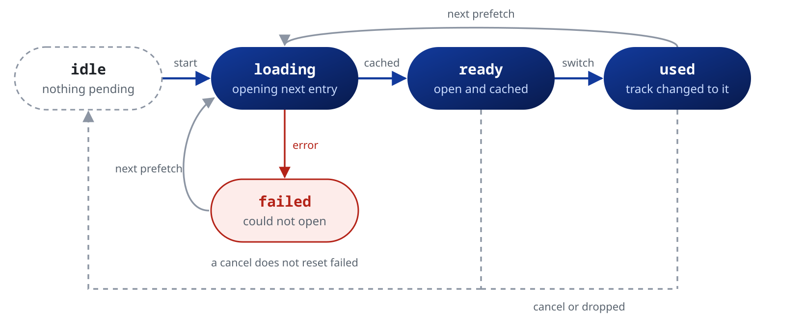

Read what the player is doing, and react when it changes.

## State and stream

The player shows its state in two ways:

- `player.state` is an immutable snapshot that you read synchronously.
- `player.stream` holds one stream per value, for `StreamBuilder` or `listen()`.

```dart
// Read once, in a handler or in build()
final volume = player.state.settings.volume;

// Follow every change
player.stream.volume.listen((v) => print('volume $v'));

// Wait for the next change only
final next = await player.stream.volume.skip(1).first;
```

A state stream gives each new listener the current value first, then every change. A `StreamBuilder` on it needs no `initialData`:

```dart
StreamBuilder<Duration>(
  stream: player.stream.position,
  builder: (context, snapshot) => Text('${snapshot.data}'),
);
```

Event streams, such as `endFile`, `error` and `log`, deliver only what happens after `listen()`.

The snapshot holds its values in six groups:

| Group | What it holds |
| --- | --- |
| `state.playback` | transport, position and the playlist |
| `state.network` | buffering, cache and read health of the source |
| `state.file` | what mpv read from the current file: tags, tracks, cover, paths |
| `state.output` | the audio output in use and its format |
| `state.settings` | what the app asked: volume, speed, effects, output, network |
| `state.versions` | the libmpv and FFmpeg versions |

The streams stay flat: `player.stream.position` follows `state.playback.position`. The flat fields of 0.6, such as `state.position`, still read the same values, deprecated until 0.8.0.

A few values live on one side only. `playbackState`, `prefetchState`, `prefetchCacheDuration`, `waveform`, `loudnessScan` and the event streams, `fft`, `pcm` and `loudnessMeter` among them, have no field in `state`. `tlsCaFile`, `readError` and `skippedSegments` have no stream.

### Current entry

```dart
final s = player.state;

// index is -1 while openAll still builds the queue
final i = s.playlist.index;
if (i >= 0 && i < s.playlist.items.length) {
  print(s.playlist.items[i].uri);
}
```

## Playback state

`playbackState` folds `playing`, `buffering`, `completed`, `pausedForCache` and the loaded file into one value, for a single indicator.

```dart
player.stream.playbackState.listen((phase) {
  switch (phase) {
    case MpvPlaybackState.idle:      // no file loaded
    case MpvPlaybackState.loading:   // a file opens
    case MpvPlaybackState.buffering: // waits for the network during playback
    case MpvPlaybackState.playing:   // produces audio
    case MpvPlaybackState.paused:    // a file is loaded, no audio
    case MpvPlaybackState.completed: // the last entry ended, no loop on
  }
});
```

A paused live stream is `paused`, not `idle`.

### Which flag to use

| Value | Use it for |
| :--- | :--- |
| `playWhenReady` | The play and pause button. Seeks and buffering leave it unchanged |
| `playing` | A spinner. It turns false during seeks and buffering |
| `playWhenReady && playing` | Audio comes out now |
| `completed` | The end of the last entry. It stays false between entries and while a loop is on |
| `buffering` | A file opens. A stall during playback shows on `pausedForCache` |
| `cacheBufferingState` | A buffering indicator, from 0 to 100 |

`bufferingPercentage` compares the cache with `state.settings.cache.secs`. It stays near 0 with the default cache size, so prefer `cacheBufferingState` or `bufferDuration` against your own target.

`duration` is `Duration.zero` for a live stream and while it is unknown. When FFmpeg estimates it from the bitrate (an MP3 without a Xing header, ADTS AAC, a length a server guessed), it can be far off: `durationEstimated` is then true, and a `Media.waveformDurationHint` takes its place. `position` updates at most about 30 times a second.

## Streams

| Group | Some streams | What for |
| :--- | :--- | :--- |
| Playback | `position`, `duration`, `volume`, `rate`, `pitch`, `seeking` | Controls and the progress bar |
| Playlist and tracks | `playlist`, `loop`, `shuffle`, `tracks`, `chapters` | The queue and its entries |
| Output | `audioDevice`, `audioDevices`, `audioParams`, `audioOutParams`, `systemVolume` | Devices and the format that plays |
| Effects | `audioEffects`, `replayGain`, `gapless` | The effects chain |
| Network and cache | `cache`, `pausedForCache`, `cacheSpeed`, `demuxerCacheState` | Buffering and download speed |
| File | `metadata`, `coverArt`, `mediaTitle`, `fileFormat`, `fileSize`, `path` | Tags and file details |
| Timing | `audioPts`, `timeRemaining`, `playtimeRemaining` | Time left, with or without the rate |
| A-B loop | `abLoopA`, `abLoopB`, `abLoopCount`, `remainingAbLoops` | The loop section |
| Analysis | `fft`, `pcm`, `waveform`, `loudnessScan`, `loudnessMeter` | Visualizers and meters |
| Media session | `mediaSession`, `mediaSessionCommands` | The OS controls |
| Events | `seekCompleted`, `endFile`, `error`, `log`, `internalLog`, `hook` | Things that happen once |

Most setters have a stream of the same name, so `setRate` changes `rate`. The API reference of `PlayerStream` and `PlayerState` lists every value with its docs.

A `null` field means the value is missing, and the field's docs say what that means. `systemVolume` is `null` on an output without a system volume, `abLoopCount` is `null` for an endless loop, and `readError` is `null` while `completed` is false.

`abLoopA` and `abLoopB` are `null` while that point is off. They return to `null` when the file they were set on ends. A point set with no file loaded stays for every file.

See the [Errors and logs](https://pub.dev/documentation/mpv_audio_kit/latest/topics/Errors%20and%20logs-topic.html), [Visualizer and analysis](https://pub.dev/documentation/mpv_audio_kit/latest/topics/Visualizer%20and%20analysis-topic.html) and [Media session](https://pub.dev/documentation/mpv_audio_kit/latest/topics/Media%20session-topic.html) topics for the event streams.

## Prefetch

With `setPrefetchPlaylist(true)`, the player opens the next entry in the background before the current one ends. `prefetchState` follows that work. See the [Playback](https://pub.dev/documentation/mpv_audio_kit/latest/topics/Playback-topic.html) topic to set up prefetch.



| State | Meaning |
| :--- | :--- |
| `idle` | No prefetch runs |
| `loading` | The next entry opens and fills its cache |
| `ready` | The next entry is open, and the next change of entry uses it |
| `used` | The entry started from the prefetch. It stays until the next `loading`, or until a cancel resets it to `idle` |
| `failed` | The next entry could not open. It stays until the next `loading` or a stop |

```dart
player.stream.prefetchState.listen((state) {
  if (state == PrefetchState.failed) print('Prefetch failed');
});

// How much of the next entry is cached, zero while nothing is prefetched
player.stream.prefetchCacheDuration.listen((buffered) {
  const target = Duration(seconds: 30);
  final progress = (buffered.inMilliseconds / target.inMilliseconds).clamp(0.0, 1.0);
  showPrefetchProgress(progress);
});
```
